# Mars Global Mosaic

[](https://github.com/loggger101/Mars_Terrestrial_GlobalMosaic_GIS-Data/actions/workflows/check.yml)

**Mapping Lava Flows, Fluvial Channels, and Impact Craters in Visible and Infrared.**
Logan M Edwards · OCN 4704 Remote Sensing · Fall 2026 · Florida Institute of Technology

An ArcGIS Pro project that co-registers Viking visible colour, THEMIS day and night thermal infrared and the HRSC/MOLA elevation model of Mars, then uses the stack to map three landform families: volcanic flow units, fluvial channels and valley networks, and impact craters. The scientific hook is Athabasca Valles, mapped for decades as a water-cut outflow channel before it was reinterpreted as flood lava. Morphology together with thermal response is this project's way of telling the two apart.

The analysis extent is **±60° latitude** (86.6% of the surface), set by the coverage of the THEMIS night mosaic. The detail work is done in two type areas: **Ius Chasma**, western Valles Marineris (271–286°E, 6–13°S), carved by water and collapse, and **Athabasca Valles** (150–162°E, 4–14°N), on flood lava. Layout 10 shows where they are; 01, 02 and 15 show each one in the inputs ([layouts](#layouts)).

This repository is the project page and an off-drive backup of the project. The working copy lives on an external drive (about 430 GB with all derived rasters, measured 2026-10-22). The tree holds everything small: the scripts, the knowledge base, the ArcGIS project file, the hand-drawn training labels and every vector layer, the layouts, the logs and the deliverables. The rasters go in two [releases](https://github.com/loggger101/Mars_Terrestrial_GlobalMosaic_GIS-Data/releases).

**Contents:** [knowledge base](Mars%20Remote%20Sensing%20Project/PROJECT-KNOWLEDGE.md) (the full record, every number tagged verified or open) · [rasters](docs/rasters.md) and [vector layers](exports/README.md) (what each one is) · [figures](docs/figures.md) (every map sheet and chart, with the script that makes it) · [build scripts](docs/scripts.md) (all 163, by purpose) · [backup and restore](docs/backup.md)

[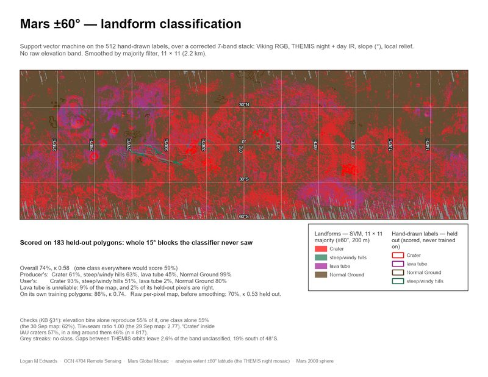](Mars%20Project/Global60/layouts/04_global60_landforms.png)
*The published landform map: four classes over ±60°, scored on hand-drawn polygons the classifier never saw (layout 04).*

## How it works

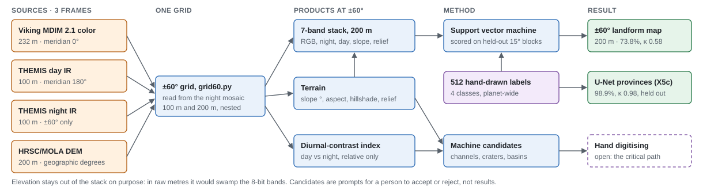

The four sources sit in three coordinate frames. Everything is put on one grid read from the night mosaic, so the day–night pair is never resampled and the DEM lands on its native 200 m. Elevation is kept out of the classification stack on purpose: in raw metres it would swamp the 8-bit bands, and an earlier map that included it turned out to be mostly an elevation map. The machine candidates are prompts for a person to accept or reject, not results.

## Where it stands (2026-10-26)

The interim report and presentation are due **mid-November 2026** and the final deliverable **8 December 2026**. Presentation 1 and the prospectus are delivered. The interim deck and report are generated from one source and rebuilt as results come in ([`NEXT STUFF/`](Mars%20Remote%20Sensing%20Project/NEXT%20STUFF)); so are drafts of the final paper (AASTeX) and deck ([`NEXT STUFF/Final/`](Mars%20Remote%20Sensing%20Project/NEXT%20STUFF/Final)). The working plan is [`NEXT-STEPS.md`](Mars%20Remote%20Sensing%20Project/NEXT-STEPS.md); how to work on the project is [`HANDOFF-DESKTOP.md`](Mars%20Remote%20Sensing%20Project/HANDOFF-DESKTOP.md).

| Task | State |
|---|---|
| Raster acquisition, including THEMIS Night IR | done; all four inputs match their published sizes, the night mosaic its MD5 too |
| CRS harmonisation (the gate) | done at ±60°: one grid, defined once in [`grid60.py`](Mars%20Remote%20Sensing%20Project/build/grid60.py) and read from the night mosaic |
| Terrain derivatives | done at ±60°: slope in degrees on a metric grid, aspect, hillshade |
| Band composite | done: a 7-band, 8-bit ±60° stack at 200 m with no raw elevation band, 97.3% co-valid |
| Unsupervised classification | done for the type area (Iso Cluster, object-based segmentation, [parameter sweep](Mars%20Remote%20Sensing%20Project/build/interim_img/ius_segmentation_sweep.png)) |
| Supervised classification | done at ±60° on the 512 hand-drawn labels, scored on held-out 15° blocks; **published as the 200 m map with an 11 × 11 (2.2 km) majority filter, 73.8%, κ 0.58** |
| Channel and crater candidates | done at ±60°: 465,354 closed depressions ≥ 1 km and 969,822 channel segments, checked against the Robbins catalogue; in both type areas; 5,144 basins ≥ 20 km |
| Deep learning | done on the held-out blocks: a RetinaNet detector (layout 16) and its retrain, scored per held-out polygon; a U-Net pixel classifier over ±60°, **98.9%, κ 0.980 held out** against the SVM map's 73.8% under the same scorer: a terrain-province map, its tile seams removed by a second, offset pass, shown beside the published SVM map (layout 17) |
| Class scheme, four classes to seven | **in progress**: Crater narrowed to impact craters, volcanic plains counted as Normal Ground, three new classes (volcanic edifice, apron, fluvial channel). The 512 labels audited: five volcanoes had been labelled Crater. The proposals are built (1,086 rows: 12 relabels, 23 to check, 574 new polygons, the rest kept) in `Landform_TrainingSamples_v2_proposals` and the map "Labels v2: proposals", **waiting for the author's review** (0 of 1,086 reviewed). The seven-class SVM and U-Net runs are rehearsed end to end on the proposals taken as proposed (`--labels v2p`: a test of the pipeline, never a result); after the review the real runs take ~22 h (SVM) and ~21 h (U-Net) (KB §68, §69.2, §69.4) |
| Landform digitising | **open, the critical path** |
| Map layouts | seventeen, below |

### Next steps

The full list, with who does what, is the "Resume here" section of [`NEXT-STEPS.md`](Mars%20Remote%20Sensing%20Project/NEXT-STEPS.md); open questions are numbered in the [knowledge base, §11](Mars%20Remote%20Sensing%20Project/PROJECT-KNOWLEDGE.md#11-open-questions).

1. **Review the machine candidates and digitise the three landform layers** (the critical path). `Landform_LavaFlowMargins`, `Landform_ChannelCenterlines` and `Landform_CraterRims` exist and are empty. Each candidate's `Review` field (accept / reject / unsure) is set in the attribute table, starting with the 188 steep, rock-floored channel candidates and the 1,685 closed depressions at Ius Chasma; `build/accept_reviewed.py` copies only the accepted ones across; what the candidates miss (breached craters, lava margins at Athabasca) is drawn by hand. Layout 14 turns each session into the detector's precision and recall. If the three layers are still empty on **1 November**, the interim presents every machine product as candidates with its measured recall, not as a landform map.
2. **The seven-class labels**: `propose_label_changes.py` has proposed a class for each of the 512 labels and new polygons for the three new classes (KB §69.2); the author accepts or rejects each; `apply_label_review.py` builds the v2 labels on the same held-out blocks; then the SVM and U-Net are rerun on them, the queue rehearsed in [`run_rehearsal_v2p.ps1`](Mars%20Remote%20Sensing%20Project/build/run_rehearsal_v2p.ps1), and D18's rule decides whether the seven-class map replaces the published one, judged on classes 1–4 (D19, KB §69.4). The interim shows the four-class and seven-class maps side by side ([`NEXT-STEPS.md` §11](Mars%20Remote%20Sensing%20Project/NEXT-STEPS.md#11-the-class-revision-d17-before-the-interim)).
3. **Deep learning**: trained and scored ([below](#deep-learning-x5)). Any further tuning first needs validation blocks of its own, apart from the held-out test blocks (KB §66.5).
4. **The retests that wait for the review**: volcanic against fluvial channels by origin (H2, stage 2), and flow margins in IR against Viking on lava margins digitised at Athabasca (H1).
5. **The interim and the final report and presentation**, from the layouts and the results below.

## Results so far

The method, the traps and every number behind these are in [`PROJECT-KNOWLEDGE.md`](Mars%20Remote%20Sensing%20Project/PROJECT-KNOWLEDGE.md); every chart is drawn from a test's log, never retyped ([figures](docs/figures.md) lists each one with its script).

### ±60° landform classification

A support vector machine on the hand-drawn labels, scored on 183 polygons in 15° blocks it never saw. The published map (200 m, 11 × 11, the map at the top) scores **73.8%, κ 0.58**, against 58.6% for one class everywhere; per pixel 69.9%, κ 0.53. Normal Ground is reliable (99% producer's) and Crater behaves as cratered terrain. The lava tube class isn't usable (2% user's accuracy).

[](Mars%20Remote%20Sensing%20Project/build/interim_img/accuracy_200m.png)

*A: where each hand-drawn class's held-out area lands on the map; each row sums to 100%, the diagonal is producer's accuracy and the row under it user's. Most lava-tube pixels fall on Crater polygons. B: each step of smoothing gains 0.4–1.8 points; the 400 m map (superseded) runs 0.6–1.7 points above the 200 m one at each window.*

### Does thermal infrared help? (test T1)

Yes, a little. With ArcGIS Pro's SVM over the whole ±60°, leaving the thermal bands out costs 1.36 points at 200 m (95% interval 0.46 to 2.47) and 1.97 at 400 m (1.08 to 3.35), from crater and hill terrain; lava tube scores better without them. A numpy classifier on the same split gives +1.3. Leaving out the Viking bands, or both spectral groups, ties the full stack inside wide intervals, but terrain alone makes a poor crater map. The hand-drawn classes are landforms, and terrain decides them.

| What each band group adds (ArcGIS Pro SVM) | Held-out accuracy by band set (numpy classifier, 400 m) |
|---|---|
| [](Mars%20Remote%20Sensing%20Project/build/interim_img/t1_pro.png) | [](Mars%20Remote%20Sensing%20Project/build/interim_img/thermal_ablation.png) |
| Dot: accuracy with all bands minus accuracy without the group; line: paired-bootstrap 95% interval over the 183 held-out polygons. Right of 0, the group helps. | Cyan: band sets that include slope and relief. The dashed line is one class everywhere. |

### Deep learning (X5)

Two deep-learning models, trained on the desktop GPU on the same training blocks as the SVM and scored on the same held-out polygons. A RetinaNet detector on 7-band chips finds Crater polygons with 41.9% recall and 87.6% precision, against 71.1% for naming every polygon Crater, and never names the two rare classes (layout 16); retrained with its backbone unfrozen it names the hills but loses the plains (Normal Ground recall 4.5%). A U-Net pixel classifier over all of ±60° scores **98.9%, κ 0.980** held out, against the published map's 73.8%, κ 0.583 under the same scorer, and raises lava tube's user's accuracy from 2% to 77%. It paints terrain provinces rather than single landforms: its 'Crater' class covers 83% of the ring around named craters as well as the craters themselves. A second pass on a grid offset by 128 px removes the seams of the tool's 256 px tiles. The SVM map stays the published one; the U-Net map sits beside it as the province map (KB §66).

[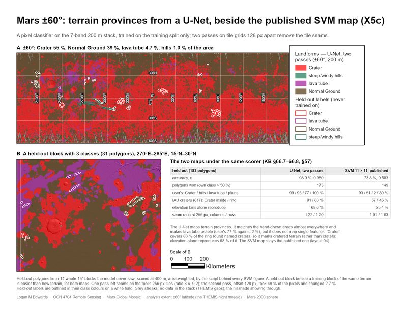](Mars%20Project/Global60/layouts/17_x5c_unet_provinces.png)

*Layout 17: the two-pass U-Net map over ±60° (A), one held-out block with its 31 hand-drawn polygons (B), and the U-Net and SVM maps under the same scorer.*

### Against calibrated thermal inertia (T3)

Across ±60°, TES thermal inertia tracks Viking red (r −0.36), while the THEMIS mosaics keep only a weak signal inside regions (|r| ≈ 0.1); in the two type areas the diurnal-contrast index does not track it. Where a calibrated product can check, visible albedo carries the material signal.

[](Mars%20Remote%20Sensing%20Project/build/interim_img/tes_check.png)

*Correlation of each layer with log thermal inertia from TES (~3 km cells): blue across all of ±60°, orange the median inside 15° blocks.*

Inside a type area the day–night pair does carry a signal that topography doesn't: at Ius Chasma the diurnal-contrast index correlates with slope at only −0.25, and the two steepest object classes sit at opposite signs. Whether that is material is untestable below the ~3 km TES resolves.

[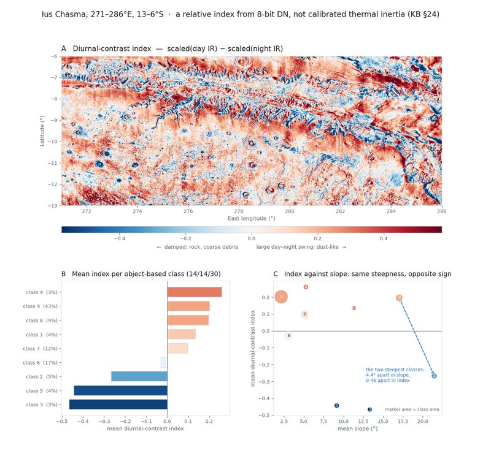](Mars%20Remote%20Sensing%20Project/build/interim_img/ius_thermal_contrast.png)

*A: the index over Ius Chasma (day and night IR each stretched on its own, then differenced; relative, not inertia). B: its mean per object-based class. C: the same means against slope (KB §24).*

The province test shows why. Over seven provinces with textbook thermal-inertia contrast, the diurnal-contrast index differs between dusty and rocky by −0.0009, against scatter of 0.13–0.23 inside each. Every province repeats the mosaic-wide mean and spread of both THEMIS mosaics, which are stretched region by region, while Viking red separates dusty from rocky by 47.67 DN.

[](Mars%20Remote%20Sensing%20Project/build/pres1_img/global60_thermal.png)

*A: index mean ± sd per province. B: DN mean ± sd in each source, the grey band the whole mosaic's; the numbers are dusty − rocky. KB §28.10.*

### Against the USGS geologic map (T8, T2)

The classes sit where terrain puts them, and volcanic plains can't be separated from other plains in these bands, so lava flows are shown from the map's volcanic units (layout 10). At Athabasca the flood lava (`lAv`) is the least cratered large unit: 1,122 catalogued craters per million km², against 1,760 and 2,183 on the older units (layout 15 outlines the unit on all four inputs).

[](Mars%20Remote%20Sensing%20Project/build/interim_img/t8_enrichment.png)

*How strongly each class gathers on each unit group of SIM 3292: red over-represented, blue under-represented (layout 13 has the map).*

Relabelling the lava-tube polygons as the map's volcanic units doesn't rescue a lava class: as a third class it is found on 21% of its held-out area, and as a fifth class only 30% of what it calls volcanic is, below the 38% share of volcanic ground in the test blocks. The four hand-drawn classes stay.

[](Mars%20Remote%20Sensing%20Project/build/interim_img/lava_relabel.png)

*Held-out accuracy on the Crater, hills and Normal Ground polygons for each scheme, classifier at 1.6 km (KB §43.3).*

T2 counts craters per unit. The catalogue ranks the flood lava lowest at Athabasca; the closed-depression detector reverses it, counting pits on flat lava that are not craters, so it can't date surfaces.

[](Mars%20Remote%20Sensing%20Project/build/interim_img/t2_density.png)

*Craters ≥ 1 km per 10⁶ km² on each unit of at least 20,000 km² in the two windows: blue the Robbins & Hynek catalogue, orange the detector. Relative density only, not an age (KB §42.2).*

### Craters

Across ±60°, 465,354 closed depressions ≥ 1 km; against the Robbins catalogue 15.3% of them are catalogued craters, 62.2% of those ≥ 5 km and 83.1% of those ≥ 20 km, each far above a chance baseline; recall levels off near half, since breached and degraded craters are invisible to a closed-depression detector. Below ~5 km the density follows the DEM's makeup more than the craters (layout 11). Large craters are measured well: Perrotin within 7.1% in diameter.

[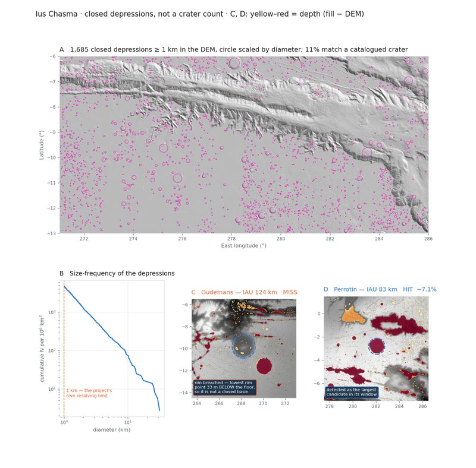](Mars%20Remote%20Sensing%20Project/build/interim_img/ius_crater_candidates.png)

*Ius Chasma: the 1,685 closed depressions ≥ 1 km (A) and their size-frequency (B); C and D, the detector on two named craters: Oudemans is breached into the canyon (its lowest rim point 33 m below its floor), so it is not a closed depression and is missed; Perrotin is found within 7.1% (KB §26).*

### Channels

`Fill` flooded Ius Chasma 2,077 m deep (21.7% of the type area raised by more than 1 m), and 56% of the stream cells in the first network were an artefact of it; of the 2,610 candidates left, 188 steep, rock-floored ones are worth digitising (layout 06). Across ±60°, 969,822 routed segments (layout 12); 89.8% lie on ground under 2°, so plateau channels are DEM noise. No channel reference exists at ±60° to score them.

[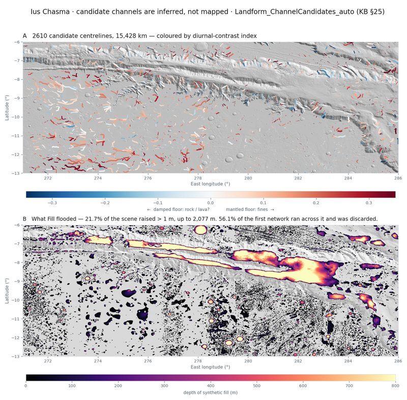](Mars%20Remote%20Sensing%20Project/build/interim_img/ius_channel_candidates.png)

*Ius Chasma. A: the 2,610 channel candidates, coloured by the diurnal-contrast index. B: where `Fill` raised the DEM, which is what the channel network had been routed across before the mask (KB §25.1).*

### The prospectus' hypotheses (T4–T7)

No band separates the geologic map's lava contacts at Athabasca much better than chance (H1, at 1:20 M); the volcanic channel candidates are shallower than the fluvial ones and thermal response doesn't tell them apart (H2, stage 1); the composite's Iso Cluster classes are the least reproducible input (H3); no channel threshold keeps first-order streams on real slopes, so the tributary order count is a setting, not a measurement (Q5).

<details>
<summary>The four charts</summary>

| T4 (H2): volcanic against fluvial channels | T5 (H1): flow margins in each band |
|---|---|
| [](Mars%20Remote%20Sensing%20Project/build/interim_img/t4_channels.png) | [](Mars%20Remote%20Sensing%20Project/build/interim_img/t5_margins.png) |
| Median gradient per window, and how well gradient and thermal response tell the windows apart (0.5 = chance). | Share of 905 profiles across 10 `lAv` contacts each band separates; chance is 10%. |
| **T6 (H3): stability of each input** | **T7 (Q5): stream orders against the threshold** |
| [](Mars%20Remote%20Sensing%20Project/build/interim_img/t6_stability.png) | [](Mars%20Remote%20Sensing%20Project/build/interim_img/t7_orders.png) |
| Agreement of maps trained on the west and east halves (ARI), and spatial coherence. | Highest Strahler order, and the share of first-order cells on slopes ≥ 2°, as the channel threshold changes. |

</details>

### Two earlier SVM maps, checked and superseded

Made in the Pro GUI: one follows its 4096-pixel processing tiles and scores below chance on its own training data; the other is mostly an elevation map (layout 05).

## Layouts

The 17 map sheets in the ArcGIS Pro project, grouped by what they show. Click one for the full sheet; [figures](docs/figures.md) gives each one's builder script and knowledge-base sections. The ±60° sheets, 08 included, are centred on 0°E; the type-area sheets are drawn on the mosaics' own grid, central meridian 180°.

**The data at ±60°**

| | |
|---|---|
| [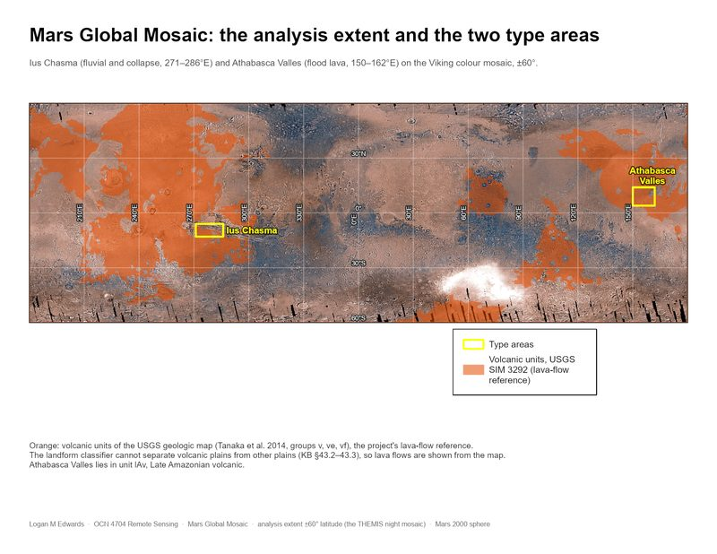](Mars%20Project/Global60/layouts/10_global60_locator.png) **10** · Where everything is: the analysis extent, the two type areas and the geologic map's volcanic units | [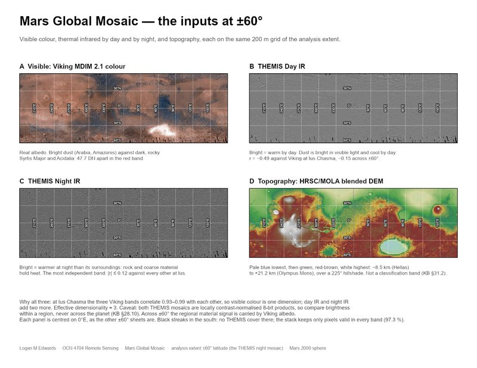](Mars%20Project/Global60/layouts/08_global60_mosaic.png) **08** · The four inputs at ±60°: visible, day IR, night IR, topography |

**The two type areas**

| | | |
|---|---|---|
| [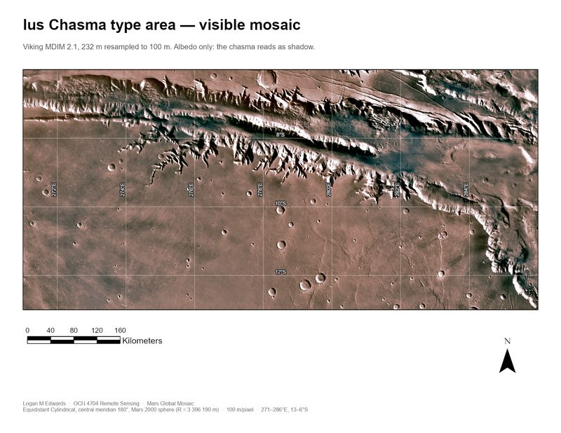](Mars%20Project/TypeArea/layouts/01_visible.png) **01** · Ius Chasma, visible (Viking colour) | [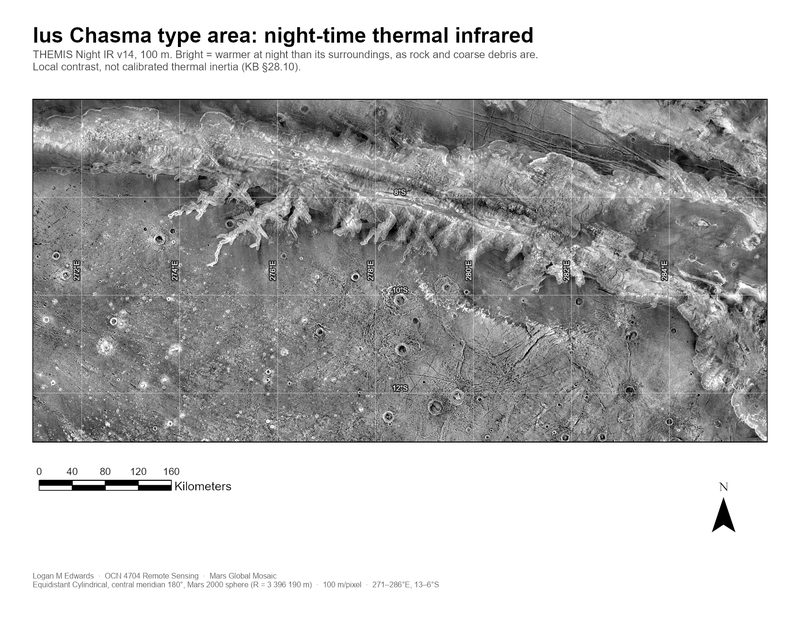](Mars%20Project/TypeArea/layouts/02_night_ir.png) **02** · Ius Chasma, night-time thermal infrared | [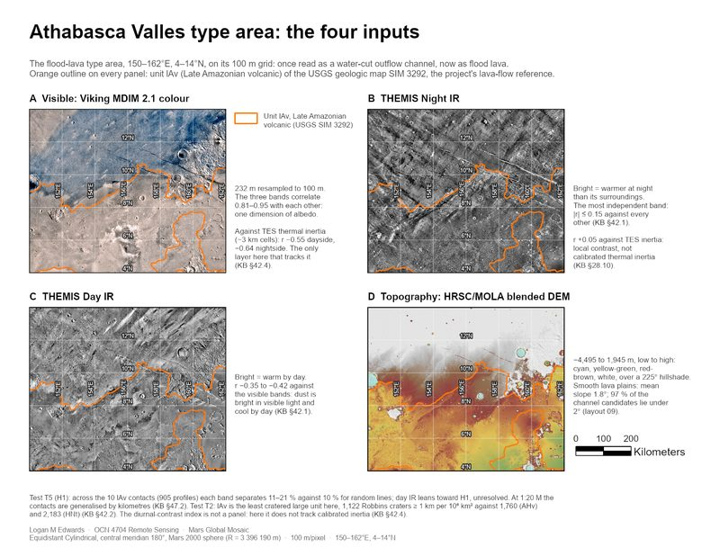](Mars%20Project/Global60/layouts/15_athabasca_type_area.png) **15** · Athabasca Valles in its four inputs, with the flood-lava unit `lAv` outlined |

**Classification**

| | |
|---|---|
| [](Mars%20Project/Global60/layouts/04_global60_landforms.png) **04** · The published ±60° landform map, scored | [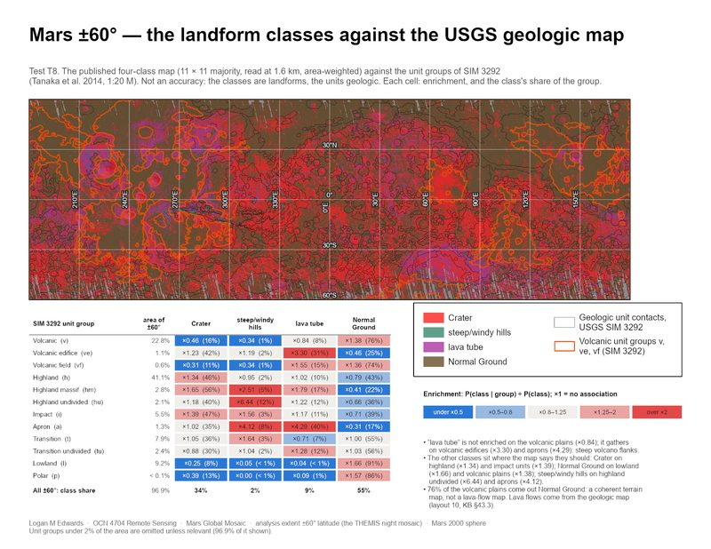](Mars%20Project/Global60/layouts/13_geomap_check.png) **13** · The classes against the USGS geologic map (T8) |
| [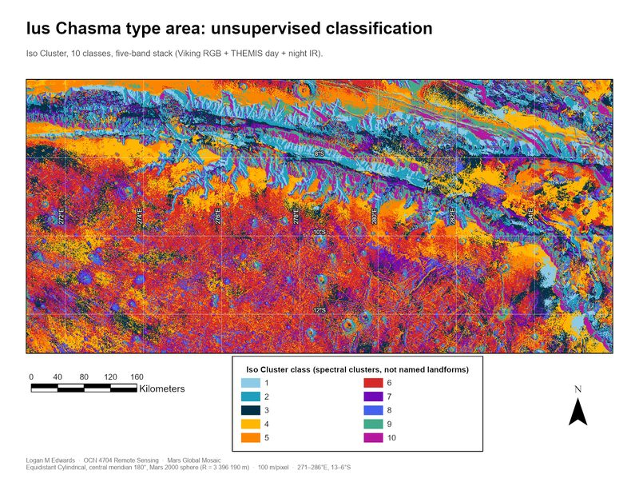](Mars%20Project/TypeArea/layouts/03_classification.png) **03** · Ius Chasma, unsupervised (Iso Cluster, 10 classes) | [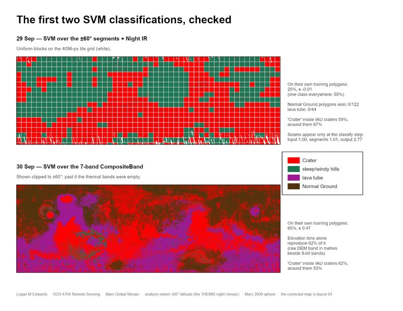](Mars%20Project/Global60/layouts/05_svm_checks.png) **05** · The first two SVM maps, checked and superseded |
| [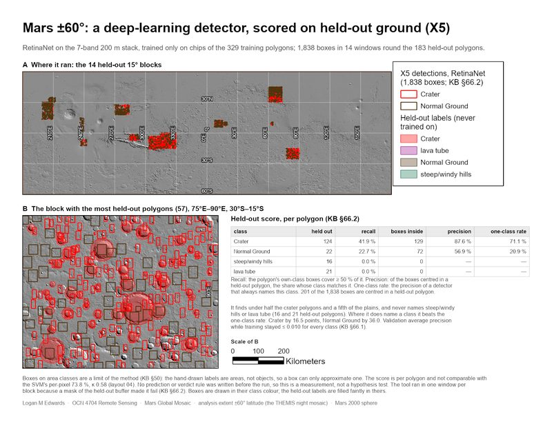](Mars%20Project/Global60/layouts/16_x5_detections.png) **16** · A deep-learning detector (X5), scored per held-out polygon | [](Mars%20Project/Global60/layouts/17_x5c_unet_provinces.png) **17** · Terrain provinces from a U-Net (X5c), beside the published SVM map |

**Craters and channels**

| | | |
|---|---|---|
| [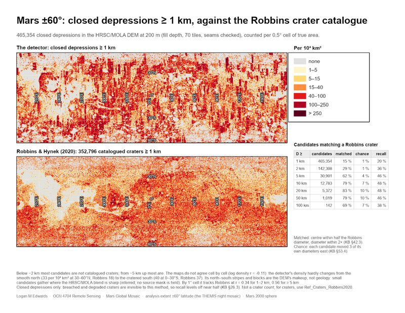](Mars%20Project/Global60/layouts/11_global60_depressions.png) **11** · Closed depressions ≥ 1 km against the Robbins catalogue | [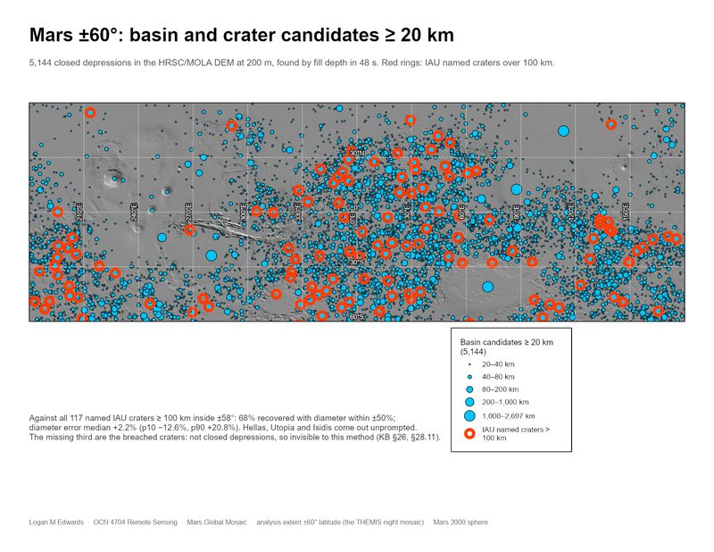](Mars%20Project/Global60/layouts/07_global60_basins.png) **07** · Basin and crater candidates ≥ 20 km | [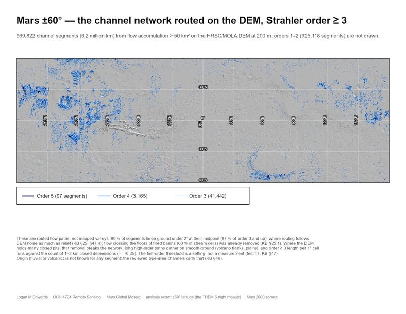](Mars%20Project/Global60/layouts/12_global60_channels.png) **12** · The channel network routed on the DEM, order ≥ 3 |

**Digitising and validation**

| | | |
|---|---|---|
| [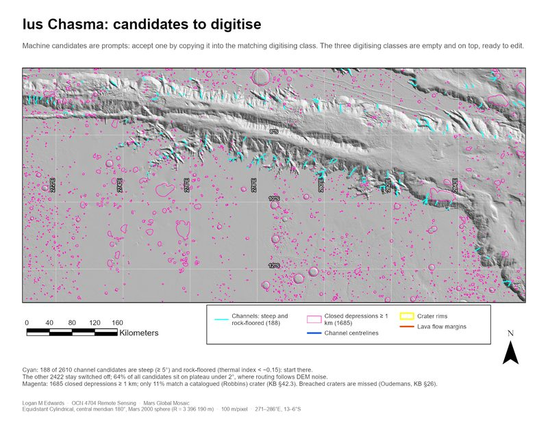](Mars%20Project/Global60/layouts/06_ius_digitising.png) **06** · Ius Chasma, candidates to digitise | [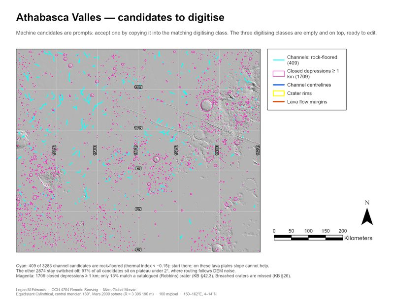](Mars%20Project/Global60/layouts/09_athabasca_digitising.png) **09** · Athabasca Valles, candidates to digitise | [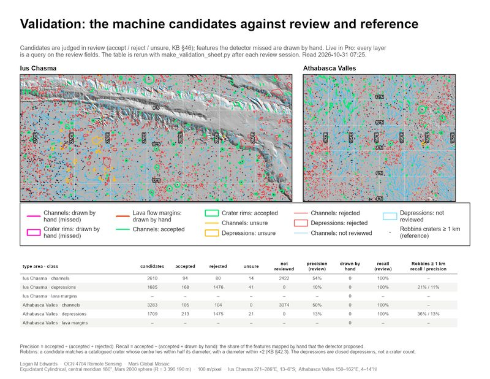](Mars%20Project/Global60/layouts/14_validation.png) **14** · Validation: the candidates against review and the Robbins catalogue |

## Source data

Not in this repository: 62 GB, public. [`tools/check_remote.py`](tools/check_remote.py), run by hand, checks that each is still served at its address at the exact size the project drive holds. Put them at the root of the project drive.

| File | Size | Grid |
|---|---|---|
| [`Mars_Viking_MDIM21_ClrMosaic_global_232m.tif`](https://asc-pds-services.s3.us-west-2.amazonaws.com/mosaic/Mars_Viking_MDIM21_ClrMosaic_global_232m.tif) | 12.7 GB | 231.5 m, central meridian 0° |
| [`Mars_MO_THEMIS-IR-Day_mosaic_global_100m_v12.tif`](https://asc-pds-services.s3.us-west-2.amazonaws.com/mosaic/Mars_MO_THEMIS-IR-Day_mosaic_global_100m_v12.tif) | 22.8 GB | 100 m, central meridian 180° |
| [`Mars_MO_THEMIS-IR-Night_mosaic_60N60S_100m_v14.tif`](https://asc-pds-services.s3.us-west-2.amazonaws.com/mosaic/Mars_MO_THEMIS-IR-Night_mosaic_60N60S_100m_v14.tif) | 15.2 GB | 100 m, central meridian 180°, ±60° |
| [`Mars_HRSC_MOLA_BlendDEM_Global_200mp_v2.tif`](https://asc-pds-services.s3.us-west-2.amazonaws.com/mosaic/Mars/HRSC_MOLA_Blend/Mars_HRSC_MOLA_BlendDEM_Global_200mp_v2.tif) | 11.4 GB | 0.00337° geographic |

The four files use three coordinate frames, so check `Central_Meridian` per file before reading a window, or THEMIS lands half a planet away. Their statistics sidecars (`.aux.xml`), the night mosaic's PDS label and MD5 are in [`drive-root/`](drive-root).

## Using the data

ArcGIS Pro is not required. The rasters are GeoTIFFs and the vectors come as a file geodatabase and a GeoPackage; QGIS and GDAL read all of them.

**Quick start.** Download the landform maps (1.8 GB; the published one unzips to `Global60/global60_landforms_svm_200m_mode11.tif`) and unzip them:

```bash
curl -LO https://github.com/loggger101/Mars_Terrestrial_GlobalMosaic_GIS-Data/releases/download/data-2026-10-21/global60-classification-part1.zip
unzip global60-classification-part1.zip
```

Then, with GDAL's Python bindings (`osgeo`, from conda-forge or the Python that ships with QGIS), read the map and turn a pixel into longitude and latitude:

```python
from osgeo import gdal
import numpy as np, math
gdal.UseExceptions()

ds = gdal.Open("Global60/global60_landforms_svm_200m_mode11.tif")  # 200 m, 106,694 x 35,565
band = ds.GetRasterBand(1)
# A tenth of the full resolution is plenty for an overview.
a = band.ReadAsArray(buf_xsize=ds.RasterXSize // 10, buf_ysize=ds.RasterYSize // 10)
names = {1: "Crater", 2: "steep/windy hills", 3: "lava tube", 4: "Normal Ground"}
valid = a != band.GetNoDataValue()                                  # 255: no class
for code, name in names.items():
    print(f"{name:18} {np.mean(a[valid] == code):6.1%}")

# Map coordinates are metres on the Mars sphere, central meridian 180°E.
R = 3396190.0
x0, dx, _, y0, _, dy = ds.GetGeoTransform()
def lonlat(col, row):
    x, y = x0 + (col + 0.5) * dx, y0 + (row + 0.5) * dy
    return 180 + math.degrees(x / R), math.degrees(y / R)           # longitude 0–360°E, latitude
```

It prints Crater 32.8%, steep/windy hills 1.8%, lava tube 9.3%, Normal Ground 56.1%, the same shares as a full-resolution count. `lonlat` agrees with PROJ's own transform to 10⁻¹³ degrees.

- **Coordinate system.** Almost everything is in `Mars_Equidistant_Cylindrical_CM180`: metres on the Mars sphere (R = 3,396,190 m) with the **central meridian at 180°**, so x runs 0–360°E. The CRS is embedded in each file; keep it. Reprojecting to an Earth CRS, or assuming a 0° meridian, puts features half a planet away. The exception is the 30 Sep SVM map, `Classified_202609300147338582853`: same projection, but **central meridian 0°**, on Viking's grid. The hand-drawn labels and the IAU nomenclature are in geographic `Mars_2000_(Sphere)`.
- **The landform map** to use is `global60_landforms_svm_200m_mode11.tif` (the 400 m maps are its superseded predecessors). Its pixel values are the class codes: **1 Crater, 2 steep/windy hills, 3 lava tube, 4 Normal Ground, 255 no class**, the same codes as the training labels; the attribute table adds names and colours. Read the lava tube class as unreliable (above). Every classified raster in the project follows the same rule: pixel value = class code.
- **The training labels** are `Landform_TrainingSamples_terrain` in [`exports/`](exports/README.md), with the same class codes 1–4. One class schema in the project swaps 2 and 3; the layer catalogue says which.
- **What each raster is**, with its grid, data type, NoData and the release that holds it: [docs/rasters.md](docs/rasters.md).

## What is in this repository

The folders mirror the drive, so a path in the knowledge base (`<drive>\Mars Project\…`) maps directly onto one here.

```
Mars Remote Sensing Project/
  PROJECT-KNOWLEDGE.md     the authoritative record: data, traps, every result, open questions
  build/                   163 scripts: every raster product, figure, layout, audit and deliverable
    logs/                  run logs and the classification scores as JSON
  NEXT STUFF/              interim report and presentation; Final/: the AASTeX paper and the final deck (drafts)
  OLD/                     prospectus and Presentation 1 (delivered; the deck as PDF)
Mars Project/
  Mars Project.aprx        the ArcGIS Pro project: 33 maps, all Mars, and 17 layouts
  Global60/, TypeArea/,    metadata sidecars, models (.ecd), raster attribute tables, layouts;
  Athabasca/               Global60/checks/ holds the DEM step chips
  DLModels/                the four deep-learning models' metadata and training plots (the
                           weight files, 137-165 MB, are in the release's dl-models.zip; the
                           seven-class rehearsal U-Net's stay on the drive)
  LabeledObjects/          deep-learning export metadata (the chips are in the release)
  GpMessages/, ImportLog/  Pro's own geoprocessing logs
exports/
  mars_project_vectors.gdb every feature class in Mars Project.gdb, including the 512 hand-drawn
                           training polygons, the candidate layers and the empty digitising classes
  README.md                the layer catalogue: rows, CRS, fields and what each layer is
docs/
  rasters.md               every backed-up raster: grid, type, NoData, what it is, which release
  backup.md                the release assets, keeping the backup current, restoring the drive
  scripts.md               every build script by purpose, with the Python it needs
  figures.md               every image in the tree: what it shows, its script, its KB section
  pipeline.svg             the diagram above
  thumbs/                  the 800 px previews these pages show; the full files are one click away
drive-root/                the source rasters' sidecars and the night mosaic's PDS label and MD5
restore.py                 rebuilds the drive from this repository and its releases
tools/check_repo.py        the checks CI runs on every push: page links, Python syntax, file sizes,
                           that the counts this page states match the tree, the figure index,
                           alt text, and previews current with their sources
tools/make_thumbs.py       rebuilds docs/thumbs/ after a layout or figure changes (needs Pillow)
tools/check_remote.py      run by hand: release assets against their checksums, linked releases,
                           the source mosaics' addresses and sizes
CITATION.cff               how to cite the project ("Cite this repository" on GitHub)
```

## Backup and restore

The rasters are in two releases: [`data-2026-10-21`](https://github.com/loggger101/Mars_Terrestrial_GlobalMosaic_GIS-Data/releases/tag/data-2026-10-21) (7.7 GB: both type areas, Ius Chasma and Athabasca Valles, the ±60° landform maps with the U-Net maps, the three trained deep-learning models, the GUI SVM maps, caches, the GeoPackage with the ±60° candidates; it replaces `data-2026-10-19`) and [`derivatives-2026-10-06`](https://github.com/loggger101/Mars_Terrestrial_GlobalMosaic_GIS-Data/releases/tag/derivatives-2026-10-06) (74.4 GB: the ±60° derivatives, split into 1.9 GB pieces, and the deep-learning exports). [`restore.py`](restore.py) rebuilds the drive from a clone and those two releases, checking every file against its SHA-256:

```bash
python restore.py --dest E:\ --dry-run
```

[docs/backup.md](docs/backup.md) lists every release asset, how the backup is kept current from the drive, and what is not backed up.

## License

- **Code** (the `.py` and `.ps1` scripts): [MIT](LICENSE).
- **Everything else made for this project**: the knowledge base, documents, figures, map layouts, the ArcGIS project file, the vector layers in `exports/` and the rasters in the releases are under [Creative Commons Attribution 4.0 International](LICENSE-CC-BY-4.0.txt) (CC BY 4.0). Use and adapt them freely, with credit:

  > Logan M Edwards (2026), *Mars Global Mosaic: Mapping Lava Flows, Fluvial Channels, and Impact Craters in Visible and Infrared*, https://github.com/loggger101/Mars_Terrestrial_GlobalMosaic_GIS-Data

- **Third-party data is not covered by either license** and keeps its producers' terms: the Viking MDIM 2.1 and HRSC/MOLA blended DEM distributed by USGS Astrogeology (the DEM blends HRSC data from DLR/ESA/FU Berlin with MOLA), the THEMIS mosaics from NASA's Mars Odyssey mission and Arizona State University, and the IAU/USGS Gazetteer of Planetary Nomenclature layers in `exports/`. The derived products carry CC BY 4.0 for this project's own contribution; credit the source missions too.
