# Figures

Every image in this repository: what it shows, the script that makes it and the knowledge-base section behind it.
Click a thumbnail for the full-size file; figures over 300 KB are shown as 800 px previews from [`thumbs/`](thumbs),
drawn by [`tools/make_thumbs.py`](../tools/make_thumbs.py), which CI checks against their sources. "KB §N" is a section of
[`PROJECT-KNOWLEDGE.md`](../Mars%20Remote%20Sensing%20Project/PROJECT-KNOWLEDGE.md); scripts are in
[`build/`](../Mars%20Remote%20Sensing%20Project/build) and described in [scripts.md](scripts.md).

- [Map layouts](#map-layouts): the 17 sheets in the ArcGIS Pro project, exported at 150 dpi
- [Result charts](#result-charts): the tests, drawn from their logs
- [Type-area figures](#type-area-figures): the Ius Chasma results behind the method choices
- [Check images](#check-images): the DEM steps found by the stack's line sweep
- [Interim crops](#interim-crops): the layouts as the interim deck uses them
- [Other](#other)

The ±60° sheets (04, 05, 07, 08, 10–13, 16, 17) are drawn in geographic Mars 2000 coordinates with 0°E at the centre; the
type-area sheets (01–03, 06, 09, 14, 15) are equidistant cylindrical on the Mars sphere, central meridian 180°, the
mosaics' own grid, and their footers say so. The analysis extent is ±60° latitude, the coverage of the THEMIS night mosaic.

## Map layouts

The layouts live in `Mars Project.aprx`. Each builder wipes and rebuilds its own maps, then
[`polish_layouts.py`](../Mars%20Remote%20Sensing%20Project/build/polish_layouts.py) applies the presentation fixes and
exports every sheet; the PNGs here are the polished exports.

### The data

| | Sheet | Built by |
|---|---|---|
|  | **10 · The analysis extent and the two type areas.** Ius Chasma and Athabasca Valles on the Viking colour mosaic, with the volcanic units of the USGS geologic map (SIM 3292), the project's lava-flow reference. KB §44. | `make_reference_maps.py` |
|  | **08 · The four inputs at ±60°.** Viking colour, THEMIS day IR, THEMIS night IR and the HRSC/MOLA topography, each on the same grid, centred on 0°E like the other ±60° sheets, with the 30° graticule. Black streaks in the south: no THEMIS coverage. KB §38, §64. | `make_mosaic_layout.py` |
|  | **01 · Ius Chasma, visible.** Viking MDIM 2.1 resampled to the type area's 100 m grid. KB §18, §22. | `make_typearea_layouts.py` |
|  | **02 · Ius Chasma, night-time thermal infrared.** THEMIS Night IR v14. Bright is warmer at night than the surroundings: local contrast, not calibrated thermal inertia. KB §22, §28.10. | `make_typearea_layouts.py` |
|  | **15 · Athabasca Valles, the four inputs.** Viking colour, THEMIS night and day IR, and the DEM over its hillshade at 100 m, with the geologic map's flood-lava unit `lAv` outlined on each; captions give each band's correlations and the T2 and T5 results there. KB §42, §47.2, §63. | `make_athabasca_layout.py` |

### Classification

| | Sheet | Built by |
|---|---|---|
|  | **04 · The published ±60° landform map.** A support vector machine on the 512 hand-drawn labels, 200 m, 11 × 11 majority filter; scored on 183 held-out polygons: 73.8 %, κ 0.58. KB §31, §55.3, §57. | `make_global60_maps.py --cell 200` |
| <a href="../Mars%20Project/Global60/layouts/04b_global60_landforms_v2.png">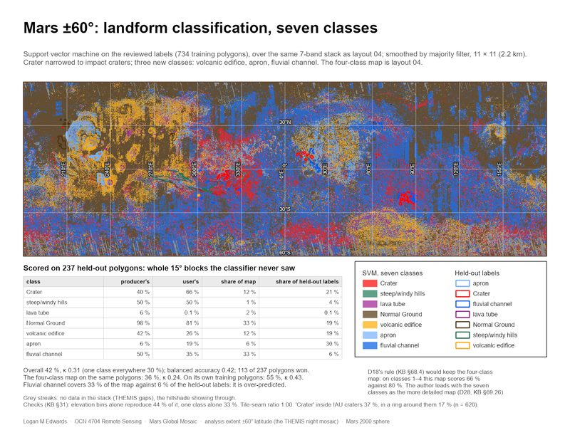</a> | **04b · The landform map in seven classes.** The same SVM and stack as 04 on the reviewed labels: Crater narrowed to impact craters, volcanic edifice, apron and fluvial channel added; scored on 237 held-out polygons, 42.5 %, κ 0.31, against the four-class map's 35.7 % on the same polygons; fluvial channel over-predicted (33 % of the map, 6 % of the labels). It leads since 2026-10-29 (D28) although D18's rule would keep 04. KB §69.24, §69.26. | `make_v2_sheets.py` |
|  | **13 · The classes against the USGS geologic map (test T8).** How strongly each class gathers on each unit group: an association, not an accuracy. KB §43.2, §57.1. | `make_geomap_sheet.py --cell 200` |
| <a href="../Mars%20Project/Global60/layouts/13b_geomap_check_v2.png">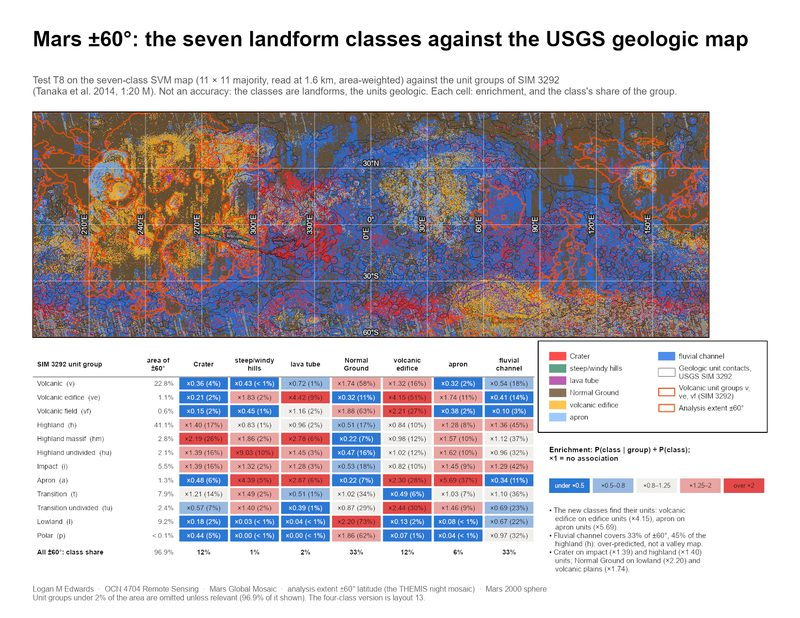</a> | **13b · The seven classes against the USGS geologic map (test T8).** As 13, for 04b: volcanic edifice ×4.15 on edifice units, apron ×5.69 on apron units. KB §69.24, §69.26. | `make_v2_sheets.py` |
|  | **03 · Ius Chasma, unsupervised classification.** Iso Cluster, 10 classes, on the five-band stack. KB §19, §22. | `make_typearea_layouts.py` |
|  | **05 · The first two SVM maps, checked and superseded.** The 29 Sep map follows its 4096-pixel tiles; the 30 Sep map is mostly elevation. KB §30, §31.1. | `make_global60_maps.py` |
|  | **16 · A deep-learning detector, scored on held-out ground (X5).** RetinaNet on the 7-band stack, 1,838 boxes round the 183 held-out polygons; per polygon, Crater recall 41.9 % and precision 87.6 % against 71.1 % for always naming Crater; the two rare classes never named. Not comparable with 04's per-pixel score. KB §66. | `make_dl_map.py` |
|  | **17 · Terrain provinces from a U-Net (X5c), beside the published SVM map.** The two-pass U-Net over ±60° and over a held-out block with three classes; under the same scorer, 98.9 %, κ 0.980 held out against the SVM map's 73.8 %, κ 0.583, lava tube user's 77 % against 2 %; 'Crater' covers 83 % of the ring round named craters, so it maps cratered terrain, not craters. The SVM map stays the published one. KB §66.7–66.9. | `make_unet_map.py` |
| <a href="../Mars%20Project/Global60/layouts/17b_unet_v2_provinces.png">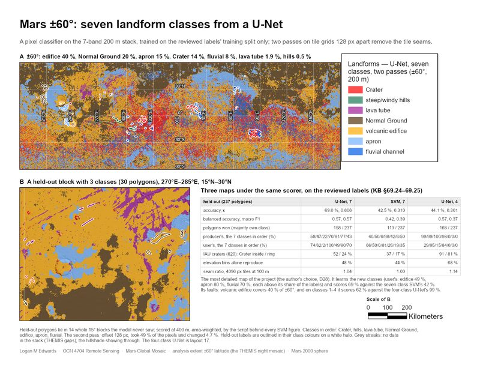</a> | **17b · Seven classes from a U-Net, beside the seven-class SVM.** The two-pass U-Net on the reviewed labels over ±60° and a held-out block; 69.0 %, κ 0.606 held out against the seven-class SVM's 42.5 % and the four-class U-Net's 44.1 % on the same polygons; volcanic edifice covers 40 % of ±60°. KB §69.25, §69.26. | `make_v2_sheets.py` |

### Craters and channels

| | Sheet | Built by |
|---|---|---|
|  | **11 · Closed depressions ≥ 1 km against the Robbins catalogue.** 465,354 depressions per 0.5° cell beside the catalogue's density, and the match rate by diameter. Below ~5 km the density follows the DEM's makeup. KB §53.4, §53.6, §54.4. | `make_global60_candidate_sheets.py` |
|  | **07 · Basin and crater candidates ≥ 20 km.** 5,144 closed depressions, sized by diameter, with the IAU named craters over 100 km. KB §28.11, §32.1. | `make_candidate_maps.py` |
|  | **12 · The channel network routed on the DEM, Strahler order ≥ 3.** 969,822 segments in all; routed flow paths, not mapped valleys. KB §53.4, §53.6, §55.4. | `make_global60_candidate_sheets.py` |

### Digitising and validation

| | Sheet | Built by |
|---|---|---|
|  | **06 · Ius Chasma, candidates to digitise.** The 188 steep, rock-floored channel candidates and 1,685 closed depressions, over the hillshade. KB §25, §32.1. | `make_candidate_maps.py` |
|  | **09 · Athabasca Valles, candidates to digitise.** 409 rock-floored channel candidates and 1,709 closed depressions on the flood lava. KB §42.1. | `make_candidate_maps.py` |
|  | **14 · Validation.** The candidates against the review (accept, reject, unsure) and the Robbins catalogue; the table fills in as the review proceeds. KB §46, §49. | `make_validation_sheet.py` |

## Result charts

Drawn from the tests' JSON logs in [`build/logs/`](../Mars%20Remote%20Sensing%20Project/build/logs) (the province chart
from the KB's own §28.10 tables), never retyped. They are the interim deck's figures, in
[`build/interim_img/`](../Mars%20Remote%20Sensing%20Project/build/interim_img) (the province chart in
[`build/pres1_img/`](../Mars%20Remote%20Sensing%20Project/build/pres1_img)). The deck itself shows navy-ground
copies of these charts and of its layout crops, made by `build/make_interim_dark.py` into `build/interim_img/dark/`
(not tracked: rerun the script to rebuild them; the report and the paper use the white originals).

| | What it shows | Made by · log |
|---|---|---|
|  | **T1 in ArcGIS Pro: what each band group adds.** Held-out accuracy of the full stack minus the stack without the group, with a paired-bootstrap 95 % interval. The thermal bands add 1.36 points at 200 m and 1.97 at 400 m, both resolved. KB §56, §56.1. | `make_fig_t1_pro.py` · `t1_bootstrap_*.json` |
|  | **The published map, scored.** A: where each hand-drawn class's held-out area lands, rows summing to 100 %, producer's accuracy on the diagonal and user's under each column (lava tube 2 %). B: held-out accuracy against the majority window at 200 m and 400 m, the published 11 × 11 circled, one class everywhere 58.6 %. KB §55.3, §57. | `make_fig_checks.py` · `global60_classification_check_*.json` |
|  | **T1 with a numpy classifier: held-out accuracy by band set**, against the 58.6 % of one class everywhere. Every set that includes slope and relief clears it; the spectral bands alone do not. KB §40.1. | `make_fig_ablation.py` · `thermal_ablation.json` |
|  | **T3: which layer tracks calibrated thermal inertia (TES)?** Correlation across ±60° and within 15° blocks. Viking red does (r −0.36); the THEMIS pair keeps only a weak local signal. KB §42.4, §43.1. | `make_fig_tes.py` · `tes_global_check.json` |
|  | **Can the day–night pair tell material apart across ±60°?** A: the diurnal-contrast index over seven provinces, dusty against rocky −0.0009 with scatter of 0.13–0.23 inside each. B: day IR, night IR and Viking red over the four provinces with tabulated DN; every province repeats the THEMIS mosaic-wide mean and spread, and Viking separates dusty from rocky by 47.67 DN, the THEMIS pair by −0.19 and +0.02. KB §28.10, §62. | `make_fig_global60.py` · KB §28.10's tables, parsed at run time |
|  | **T8: each class's enrichment on each geologic unit group**, P(class \| group) ÷ P(class). Layout 13's table, legible at slide size. KB §43.2, §57.1. | `make_fig_t8.py` · `geomap_check.json` |
|  | **The lava-tube relabel.** Held-out accuracy on the Crater, hills and Normal Ground polygons for four class schemes; a 'volcanic' class from the geologic map is right on 30 % of what it calls volcanic, below the 38 % base rate, so the four hand-drawn classes stay. KB §43.3. | `make_fig_checks.py` · `lava_relabel_test.json` |
|  | **T2: crater density per geologic unit.** Craters ≥ 1 km per 10⁶ km² on each unit ≥ 20,000 km² of the two windows. The catalogue puts `lAv` lowest at Athabasca (1,122); the detector does not, so it cannot date surfaces. KB §42.2. | `make_fig_checks.py` · `crater_density.json` |
|  | **T4 (H2, stage 1): volcanic against fluvial channels.** The Athabasca candidates are shallower than Ius's, and thermal response does not tell the two windows apart (AUC 0.50). KB §51.1. | `make_fig_t4.py` · `t4_channel_h2.json` |
|  | **T5 (H1): does IR show lava-flow margins?** The share of 905 profiles across the geologic map's `lAv` contacts that each band separates; every interval reaches chance. KB §47.2. | `make_fig_tests567.py` · `t5_flow_margins.json` |
|  | **T6 (H3): is the composite more stable than one input?** Agreement of west- and east-trained maps (ARI) and spatial coherence; the composites are the least reproducible. KB §47.3. | `make_fig_tests567.py` · `t6_composite_stability.json` |
|  | **T7 (Q5): how many stream orders does the DEM resolve?** The highest order falls with the channel threshold, and no threshold puts half the first-order cells on real slopes: the count is a setting. KB §47.4. | `make_fig_tests567.py` · `t7_order_sweep.json` |
|  | **Closed depressions against the Robbins crater database**, by minimum diameter: precision rises from 15.3 % at ≥ 1 km to 62.2 % at ≥ 5 km, recall levels off near one half, beside the chance baseline. A final-deck chart. KB §53.4, §69. | `make_fig_final.py` · `global60_candidates_check.json` |
|  | **The published SVM map against the U-Net, class by class:** producer's and user's accuracy on the 183 held-out polygons under one scorer; lava tube's user's accuracy 2.4 % against 77.1 %. A final-deck chart. KB §57, §66.8, §69. | `make_fig_final.py` · `global60_classification_check_*.json` |

## Type-area figures

The Ius Chasma results that set the method: the segmentation parameters, the `Fill` mask, the detector's limits and
what the day–night pair can show. Drawn from the type-area rasters with `--light`, which writes these to
[`build/interim_img/`](../Mars%20Remote%20Sensing%20Project/build/interim_img); without it, each script writes
Presentation 1's navy original (not mirrored).

| | What it shows | Made by |
|---|---|---|
| <a href="../Mars%20Remote%20Sensing%20Project/build/interim_img/ius_segmentation_sweep.png">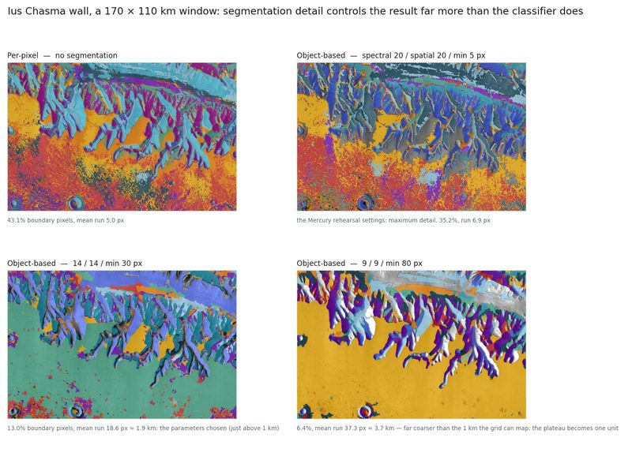</a> | **The segmentation sweep.** The same 170 × 110 km of the chasma wall per pixel and at three object-based settings; boundary pixels fall from 43.1 % to 13.0 % at 14 / 14 / 30, the settings chosen, whose 1.9 km mean run sits just above the grid's 1 km mapping limit. KB §23.5. | `make_fig_segmentation.py --light` |
|  | **The diurnal-contrast index at Ius Chasma.** The map, its mean per object-based class, and the class means against slope: the two steepest classes, 4.4° apart, sit 0.46 apart at opposite signs. Relative 8-bit DN, not inertia; at ~3 km it does not track TES. KB §24, §42.4. | `make_fig_thermal.py --light` |
|  | **Channel candidates and the `Fill` trap.** A: the 2,610 candidates by diurnal-contrast index. B: where `Fill` raised the DEM (21.7 % of the area, up to 2,077 m); 56.1 % of the first network ran across it. KB §25. | `make_fig_channels.py --light` |
|  | **Closed depressions and the detector's limit.** The 1,685 depressions ≥ 1 km, their size-frequency, and two named craters: Oudemans, breached, missed; Perrotin found within 7.1 %. KB §26, §42.3. | `make_fig_craters.py --light` |

## Check images

[`Mars Project/Global60/checks/dem_step_chips_20261015/`](../Mars%20Project/Global60/checks/dem_step_chips_20261015):
image chips at each line in the DEM that the sweep of the 7-band stack flagged (steps 2.2–4× the local roughness, ~500 km
long). 297.5°E is a real escarpment; the others are seams and smoothed gap-fill strips in the HRSC/MOLA blend, not fixable
in this project. `180E_col53346_after_fix` shows the 180° column after its patch. KB §54, §55.2.

| | | |
|---|---|---|
| <a href="../Mars%20Project/Global60/checks/dem_step_chips_20261015/180E_col53346_after_fix.png">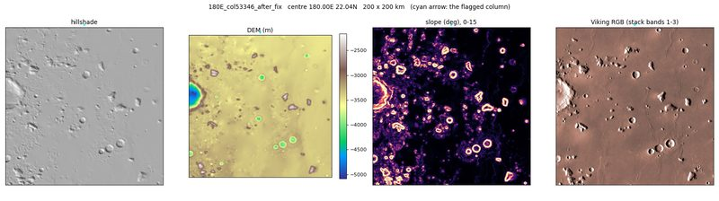</a> 180°E, after the fix | <a href="../Mars%20Project/Global60/checks/dem_step_chips_20261015/297.5E_col88163.png">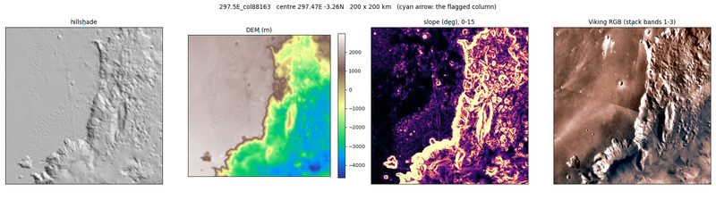</a> 297.5°E, a real escarpment | <a href="../Mars%20Project/Global60/checks/dem_step_chips_20261015/304.4E_col90211.png">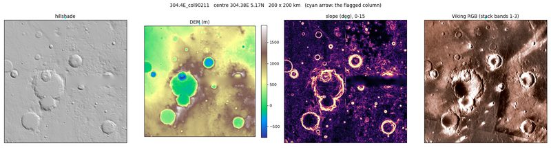</a> 304.4°E, a seam |
| <a href="../Mars%20Project/Global60/checks/dem_step_chips_20261015/345.8E_col102499_a.png">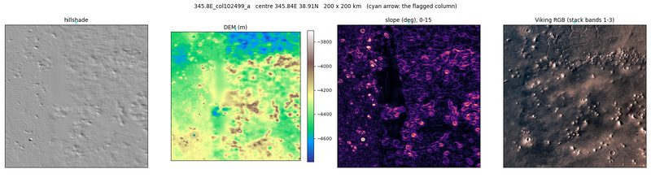</a> 345.8°E (a), a seam | <a href="../Mars%20Project/Global60/checks/dem_step_chips_20261015/345.8E_col102499_b.png">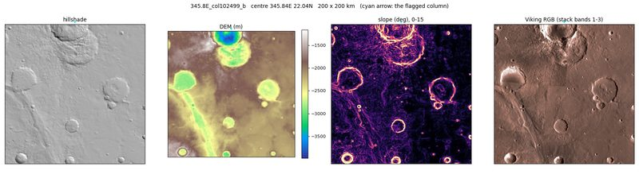</a> 345.8°E (b), a seam | <a href="../Mars%20Project/Global60/checks/dem_step_chips_20261015/61.9E_col18333.png">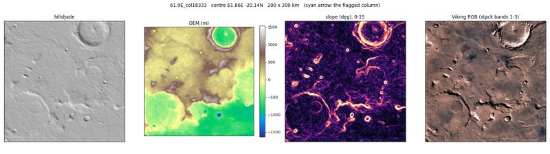</a> 61.9°E, a seam |
| <a href="../Mars%20Project/Global60/checks/dem_step_chips_20261015/15.0S_row22230.png">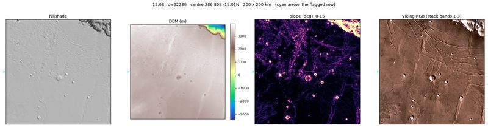</a> 15.0°S (a row), a seam | | |

## Deep-learning model (X5)

Written by `TrainDeepLearningModel` beside the model in
[`Mars Project/DLModels/global60_retinanet_20261019/`](../Mars%20Project/DLModels/global60_retinanet_20261019) (the
weights, 137–146 MB, stay on the drive). Validation chips come from the training split: **not the held-out score**.
KB §66.1.

| | What it shows | Made by |
|---|---|---|
|  | **Training and validation loss**, nine epochs of RetinaNet on the 7-band chips; early stopping kept epoch 3 (validation loss 1.567). | `make_dl_model.py --train` |
| <a href="../Mars%20Project/DLModels/global60_retinanet_20261019/ModelCharacteristics/show_results.png">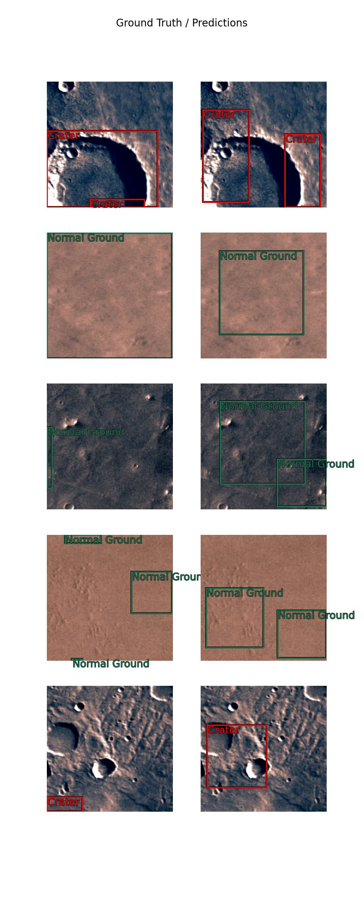</a> | **Labels against predictions** on five validation chips: the right class on crater and plains chips, boxes unlike the labels' whole-chip extents (validation AP ≤ 0.010 per class). | `make_dl_model.py --train` |

### X5b and X5c (2026-10-20)

The retrained detector and the U-Net, in [`global60_retinanet_x5b_20261020/`](../Mars%20Project/DLModels/global60_retinanet_x5b_20261020)
and [`global60_unet_x5c_20261020/`](../Mars%20Project/DLModels/global60_unet_x5c_20261020); validation chips from the
training split, **not the held-out score** (KB §66.5–66.6).

| | What it shows | Made by |
|---|---|---|
|  | **X5b loss**, 30 epochs with the backbone unfrozen and no early stopping; validation loss 428 after the first epoch, 1.2–4.4 after; epoch 16 kept (1.203). | `make_dl_model.py --train` |
| <a href="../Mars%20Project/DLModels/global60_retinanet_x5b_20261020/ModelCharacteristics/show_results.png">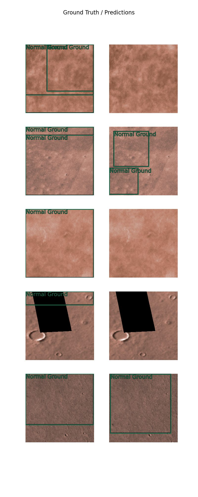</a> | **X5b labels against predictions** on five validation chips, all Normal Ground: three get no box, one two boxes smaller than the label, one a box close to it (its validation AP for Normal Ground is 0.000). | `make_dl_model.py --train` |
|  | **X5c loss**, the U-Net, 30 epochs; validation loss 0.466 to 0.029, epoch 29 kept. | `make_dl_pixels.py --train` |
| <a href="../Mars%20Project/DLModels/global60_unet_x5c_20261020/ModelCharacteristics/show_results.png">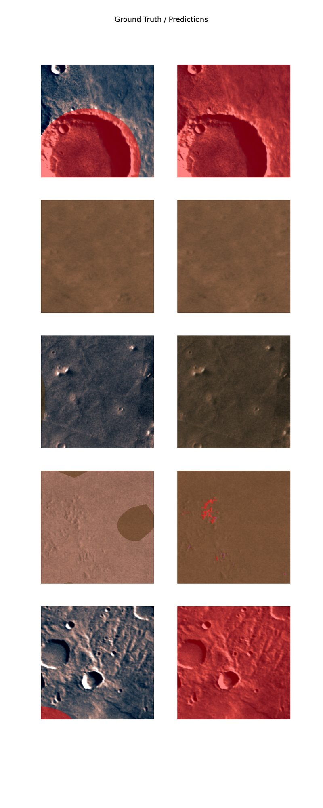</a> | **X5c labels against predictions** on five validation chips: the labelled crater right, and the whole chip around it called Crater too (the provinces of KB §66.6). | `make_dl_pixels.py --train` |

### The seven-class rehearsal U-Net (2026-10-25)

Trained on the rehearsal labels, every proposal taken as proposed and **not the author's review**, in
[`global60_unet_x5c_v2p_20261025/`](../Mars%20Project/DLModels/global60_unet_x5c_v2p_20261025): a test of the
v2 pipeline, never a result (KB §69.4). Validation chips from the training split, not the held-out score.

| | What it shows | Made by |
|---|---|---|
|  | **Rehearsal U-Net loss**, seven classes, 30 epochs over 21,711 chips (7.8 h); validation loss from 0.81 to 0.25. | `make_dl_pixels.py --train --labels v2p` |
| <a href="../Mars%20Project/DLModels/global60_unet_x5c_v2p_20261025/ModelCharacteristics/show_results.png">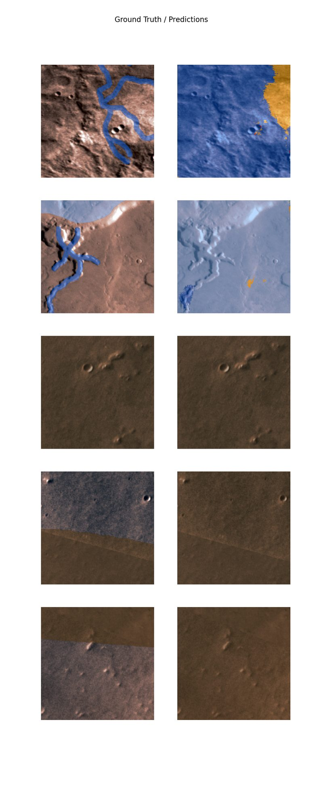</a> | **Rehearsal U-Net labels against predictions** on five validation chips: around a valley strip the whole chip is called fluvial channel, with volcanic edifice at its edge; a second chip is called apron throughout and its channel strip is missed; the last three are called Normal Ground. | `make_dl_pixels.py --train --labels v2p` |

### The seven-class U-Net on the reviewed labels (2026-10-28)

Trained on the reviewed v2 labels (KB §69.8) in
[`global60_unet_x5c_v2_20261028/`](../Mars%20Project/DLModels/global60_unet_x5c_v2_20261028): 69.0 %, κ 0.606 on the 237 held-out polygons, reported as a test
beside the four-class U-Net (KB §69.25). Validation chips from the training split, not the held-out score.

| | What it shows | Made by |
|---|---|---|
|  | **v2 U-Net loss**, seven classes, 30 epochs over 17,444 chips (6.2 h); validation loss from 0.90 to 0.30. | `make_dl_pixels.py --train --labels v2` |
| <a href="../Mars%20Project/DLModels/global60_unet_x5c_v2_20261028/ModelCharacteristics/show_results.png">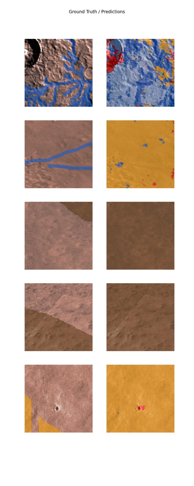</a> | **v2 U-Net labels against predictions** on five validation chips: a branching valley network is called apron and fluvial channel across the whole chip, with Crater on the crater beside it; a chip with two channel strips is called volcanic edifice throughout and the strips are missed; two chips labelled Normal Ground in part are called Normal Ground throughout; a chip with volcanic edifice in one corner is called volcanic edifice throughout, with Crater on its small crater. | `make_dl_pixels.py --train --labels v2` |

## Interim crops

[`build/interim_img/`](../Mars%20Remote%20Sensing%20Project/build/interim_img) also holds each layout the interim deck
shows, exported at 200 dpi with the sheet's own prose hidden by
[`make_interim_figs.py`](../Mars%20Remote%20Sensing%20Project/build/make_interim_figs.py). A sheet with a legend yields
three files: the whole sheet, `__map` (the map alone, full width on the slide) and `__legend`. They are the same maps as
the layouts above, all 13 re-exported from the current sheets on 2026-10-22 (KB §67).

[`build/final_img/`](../Mars%20Remote%20Sensing%20Project/build/final_img) holds the same kind of crops for the
final deck (layouts 04, 07, 08, 10, 12, 15, 16, 17), exported by
[`make_final_figs.py`](../Mars%20Remote%20Sensing%20Project/build/make_final_figs.py), beside the two charts above. The
final paper's [`figures/`](../Mars%20Remote%20Sensing%20Project/NEXT%20STUFF/Final/paper/figures) folder holds copies of
figures on this page, put there by `build_final_paper.py` so the `.tex` compiles on its own (KB §69).

## Other

| | What it shows | Made by |
|---|---|---|
| [`pipeline.svg`](pipeline.svg) | The pipeline diagram on the front page. | by hand |
| [`NEXT STUFF/Final/paper/mars_global_mosaic.pdf`](../Mars%20Remote%20Sensing%20Project/NEXT%20STUFF/Final/paper/mars_global_mosaic.pdf) | The final paper, a draft in AASTeX 7 (14 pages); the machine products presented as candidates while the review is open. KB §69. | `build_final_paper.py` |
| [`OLD/ocean first pres LE.pdf`](../Mars%20Remote%20Sensing%20Project/OLD/ocean%20first%20pres%20LE.pdf) | Presentation 1 as delivered (history, not corrected). KB §14.5. | — |
