# Figures

Every image in this repository: what it shows, the script that makes it and the knowledge-base section behind it.
Click a thumbnail for the full-size file; figures over 300 KB are shown as 800 px previews from [`thumbs/`](thumbs),
drawn by [`tools/make_thumbs.py`](../tools/make_thumbs.py), which CI checks against their sources. "KB §N" is a section of
[`PROJECT-KNOWLEDGE.md`](../Mars%20Remote%20Sensing%20Project/PROJECT-KNOWLEDGE.md); scripts are in
[`build/`](../Mars%20Remote%20Sensing%20Project/build) and described in [scripts.md](scripts.md).

- [Map layouts](#map-layouts): the 17 sheets in the ArcGIS Pro project, exported at 150 dpi
- [Result charts](#result-charts): the tests, drawn from their logs
- [Type-area figures](#type-area-figures): the Ius Chasma results behind the method choices
- [Check images](#check-images): the DEM steps found by the stack's line sweep
- [Interim crops](#interim-crops): the layouts as the interim deck uses them
- [Other](#other)

The ±60° sheets (04, 05, 07, 08, 10–13, 16, 17) are drawn in geographic Mars 2000 coordinates with 0°E at the centre; the
type-area sheets (01–03, 06, 09, 14, 15) are equidistant cylindrical on the Mars sphere, central meridian 180°, the
mosaics' own grid, and their footers say so. The analysis extent is ±60° latitude, the coverage of the THEMIS night mosaic.

## Map layouts

The layouts live in `Mars Project.aprx`. Each builder wipes and rebuilds its own maps, then
[`polish_layouts.py`](../Mars%20Remote%20Sensing%20Project/build/polish_layouts.py) applies the presentation fixes and
exports every sheet; the PNGs here are the polished exports.

### The data

| | Sheet | Built by |
|---|---|---|
| <a href="../Mars%20Project/Global60/layouts/10_global60_locator.png">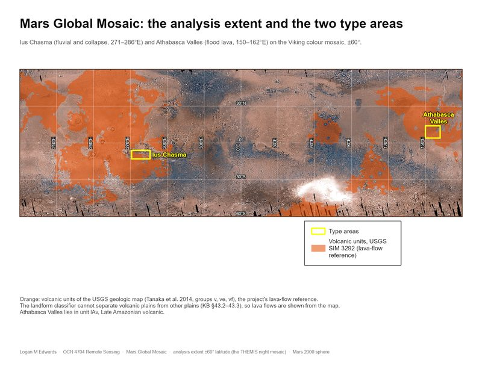</a> | **10 · The analysis extent and the two type areas.** Ius Chasma and Athabasca Valles on the Viking colour mosaic, with the volcanic units of the USGS geologic map (SIM 3292), the project's lava-flow reference. KB §44. | `make_reference_maps.py` |
| <a href="../Mars%20Project/Global60/layouts/08_global60_mosaic.png">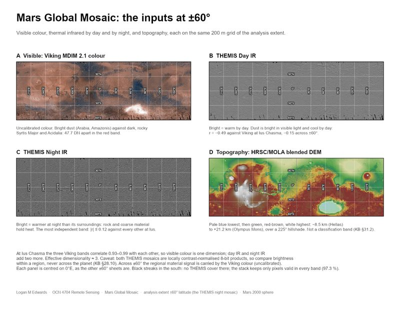</a> | **08 · The four inputs at ±60°.** Viking colour, THEMIS day IR, THEMIS night IR and the HRSC/MOLA topography, each on the same grid, centred on 0°E like the other ±60° sheets, with the 30° graticule. Black streaks in the south: no THEMIS coverage. KB §38, §64. | `make_mosaic_layout.py` |
| <a href="../Mars%20Project/Global60/layouts/18_t3_tes_blocks.png">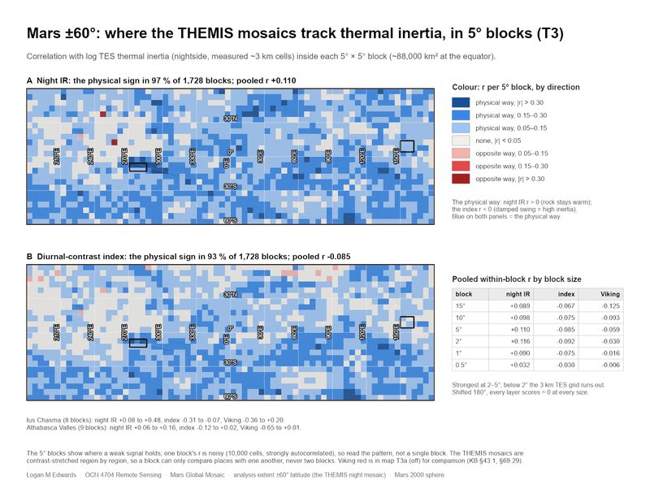</a> | **18 · Where the THEMIS mosaics track thermal inertia, in 5° blocks (T3).** Night IR and the diurnal-contrast index against TES thermal inertia inside each 5° × 5° block, blue for the physical direction on both maps: the physical sign in 97 % and 93 % of 1,728 blocks, strongest on high-inertia southern ground and in Ius Chasma's row (night IR r +0.31 to +0.48), weak on the dusty northern provinces and at Athabasca. KB §69.29, §69.30. | `make_tes_block_layout.py` |
| <a href="../Mars%20Project/TypeArea/layouts/01_visible.png">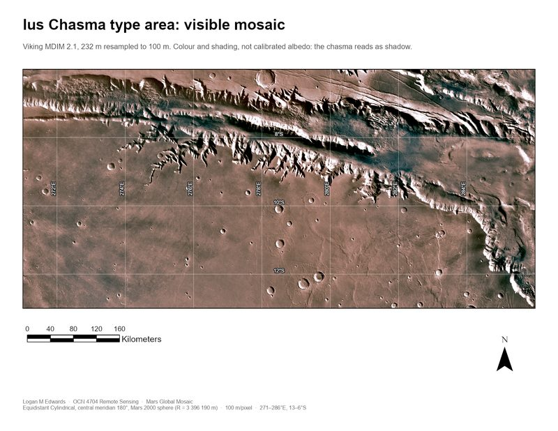</a> | **01 · Ius Chasma, visible.** Viking MDIM 2.1 resampled to the type area's 100 m grid. KB §18, §22. | `make_typearea_layouts.py` |
| <a href="../Mars%20Project/TypeArea/layouts/02_night_ir.png">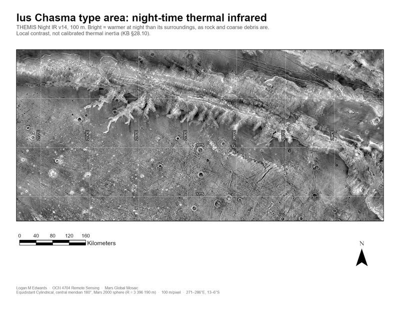</a> | **02 · Ius Chasma, night-time thermal infrared.** THEMIS Night IR v14. Bright is warmer at night than the surroundings: local contrast, not calibrated thermal inertia. KB §22, §28.10. | `make_typearea_layouts.py` |
| <a href="../Mars%20Project/Global60/layouts/15_athabasca_type_area.png">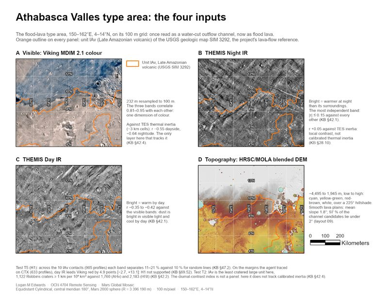</a> | **15 · Athabasca Valles, the four inputs.** Viking colour, THEMIS night and day IR, and the DEM over its hillshade at 100 m, with the geologic map's flood-lava unit `lAv` outlined on each; captions give each band's correlations and the T2 and T5 results there. KB §42, §47.2, §63. | `make_athabasca_layout.py` |

### Classification

| | Sheet | Built by |
|---|---|---|
| <a href="../Mars%20Project/Global60/layouts/04_global60_landforms.png">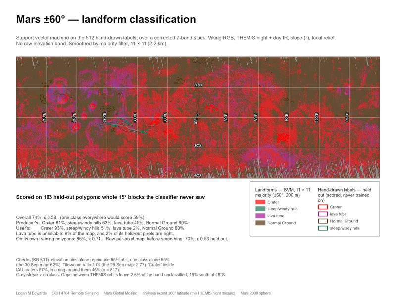</a> | **04 · The published ±60° landform map.** A support vector machine on the 512 hand-drawn labels, 200 m, 11 × 11 majority filter; scored on 183 held-out polygons: 73.8 %, κ 0.58. KB §31, §55.3, §57. | `make_global60_maps.py --cell 200` |
| <a href="../Mars%20Project/Global60/layouts/04b_global60_landforms_v2.png">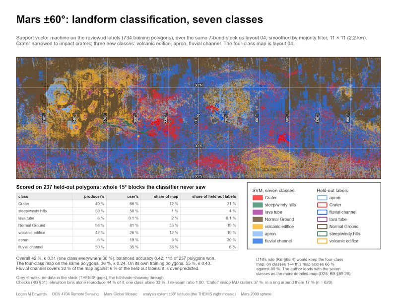</a> | **04b · The landform map in seven classes.** The same SVM and stack as 04 on the reviewed labels: Crater narrowed to impact craters, volcanic edifice, apron and fluvial channel added; scored on 237 held-out polygons, 42.5 %, κ 0.31, against the four-class map's 35.7 % on the same polygons; fluvial channel over-predicted (33 % of the map, 6 % of the labels). It leads since 2026-10-29 (D28) although D18's rule would keep 04. KB §69.24, §69.26. | `make_v2_sheets.py` |
| <a href="../Mars%20Project/Global60/layouts/04c_global60_landforms_v3.png">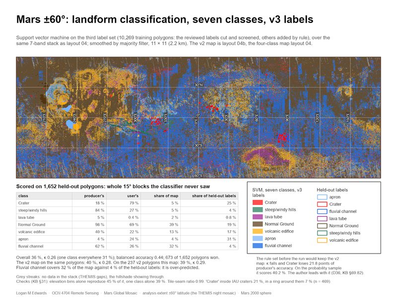</a> | **04c · The seven-class SVM map on the third label set.** 39.1 %, κ 0.29 on the 237 v2 polygons, 36.5 % on the 1,652; a lead map against the rule set for it (D36). |
| <a href="../Mars%20Project/Global60/layouts/13_geomap_check.png">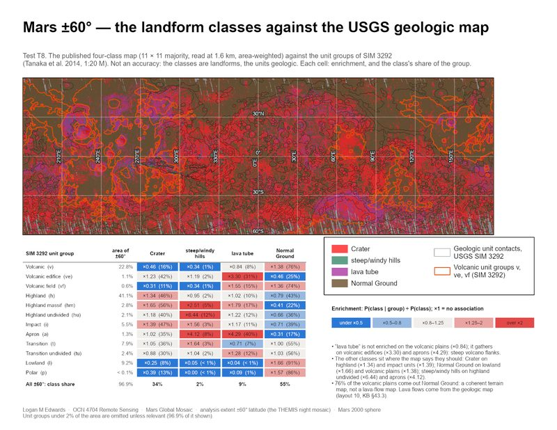</a> | **13 · The classes against the USGS geologic map (test T8).** How strongly each class gathers on each unit group: an association, not an accuracy. KB §43.2, §57.1. | `make_geomap_sheet.py --cell 200` |
| <a href="../Mars%20Project/Global60/layouts/13b_geomap_check_v2.png">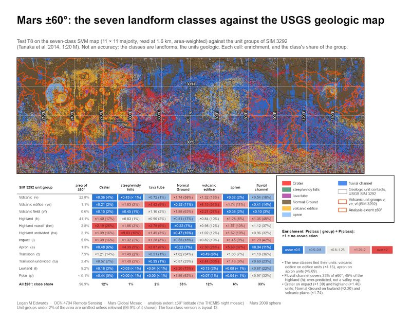</a> | **13b · The seven classes against the USGS geologic map (test T8).** As 13, for 04b: volcanic edifice ×4.15 on edifice units, apron ×5.69 on apron units. KB §69.24, §69.26. | `make_v2_sheets.py` |
| <a href="../Mars%20Project/Global60/layouts/13c_geomap_check_v3.png">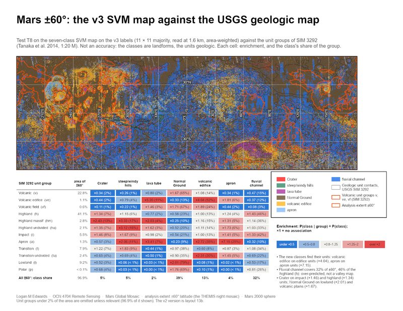</a> | **13c · The v3 maps against the geologic map.** Both v3 maps by unit group, with the crater and valley checks. |
| <a href="../Mars%20Project/TypeArea/layouts/03_classification.png">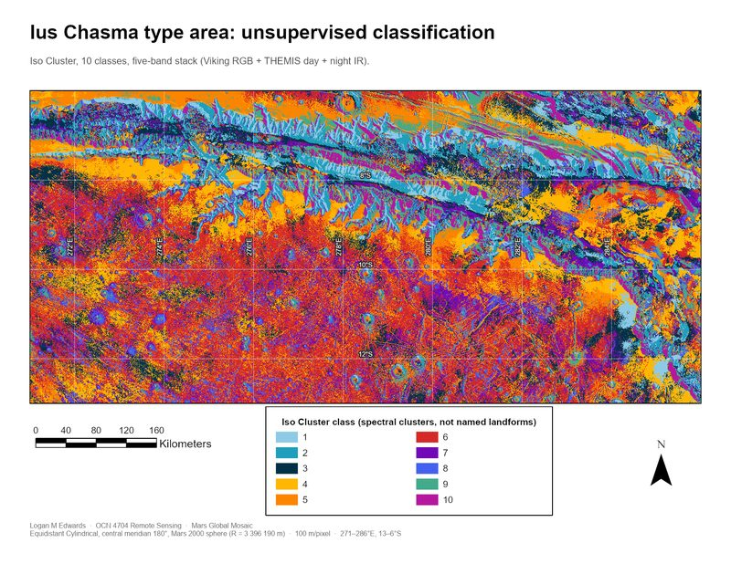</a> | **03 · Ius Chasma, unsupervised classification.** Iso Cluster, 10 classes, on the five-band stack. KB §19, §22. | `make_typearea_layouts.py` |
| <a href="../Mars%20Project/Global60/layouts/05_svm_checks.png">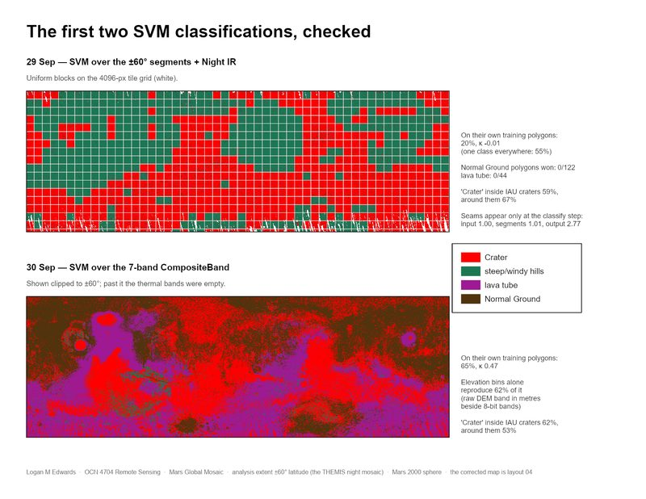</a> | **05 · The first two SVM maps, checked and superseded.** The 29 Sep map follows its 4096-pixel tiles; the 30 Sep map is mostly elevation. KB §30, §31.1. | `make_global60_maps.py` |
| <a href="../Mars%20Project/Global60/layouts/16_x5_detections.png">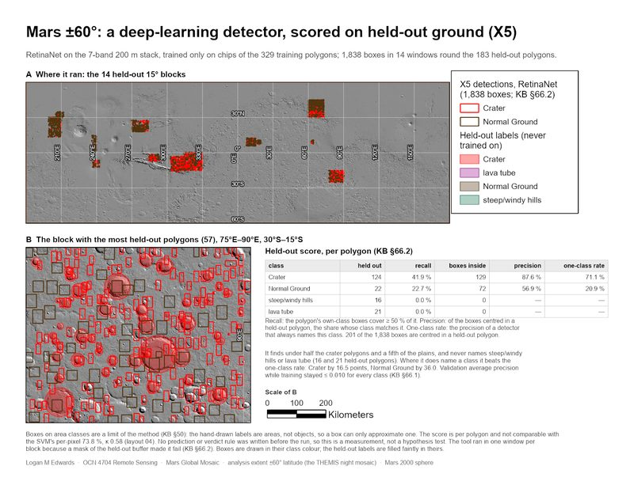</a> | **16 · A deep-learning detector, scored on held-out ground (X5).** RetinaNet on the 7-band stack, 1,838 boxes round the 183 held-out polygons; per polygon, Crater recall 41.9 % and precision 87.6 % against 71.1 % for always naming Crater; the two rare classes never named. Not comparable with 04's per-pixel score. KB §66. | `make_dl_map.py` |
| <a href="../Mars%20Project/Global60/layouts/17_x5c_unet_provinces.png">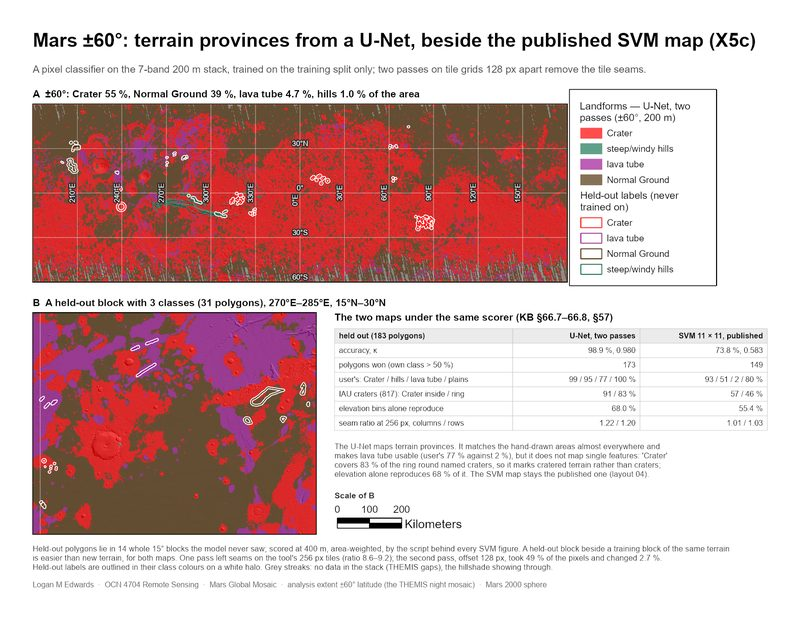</a> | **17 · Terrain provinces from a U-Net (X5c), beside the published SVM map.** The two-pass U-Net over ±60° and over a held-out block with three classes; under the same scorer, 98.9 %, κ 0.980 held out against the SVM map's 73.8 %, κ 0.583, lava tube user's 77 % against 2 %; 'Crater' covers 83 % of the ring round named craters, so it maps cratered terrain, not craters. The SVM map stays the published one. KB §66.7–66.9. | `make_unet_map.py` |
| <a href="../Mars%20Project/Global60/layouts/17b_unet_v2_provinces.png">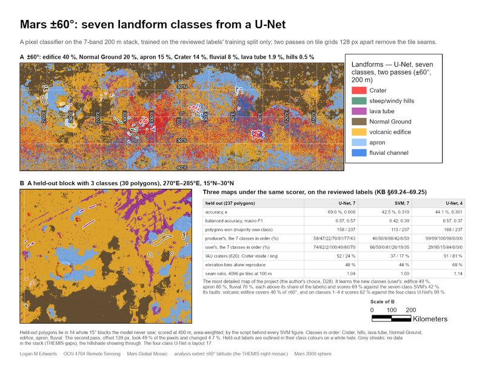</a> | **17b · Seven classes from a U-Net, beside the seven-class SVM.** The two-pass U-Net on the reviewed labels over ±60° and a held-out block; 69.0 %, κ 0.606 held out against the seven-class SVM's 42.5 % and the four-class U-Net's 44.1 % on the same polygons; volcanic edifice covers 40 % of ±60°. KB §69.25, §69.26. | `make_v2_sheets.py` |
| <a href="../Mars%20Project/Global60/layouts/17c_unet_v3_provinces.png">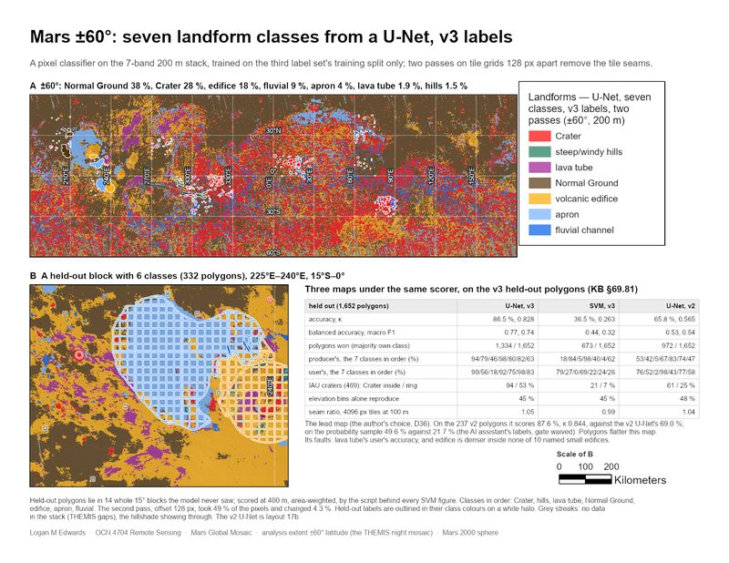</a> | **17c · Seven classes from a U-Net on the third label set.** The lead map: 87.6 %, κ 0.844 on the 237 v2 polygons, 49.6 % on a probability sample (the AI assistant's labels). |
| <a href="../Mars%20Project/Global60/layouts/20_labels_v3.png">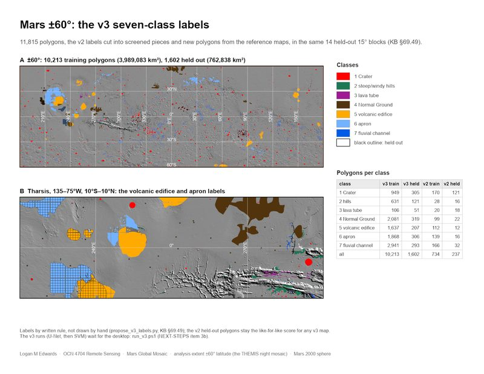</a> | **20 · The v3 seven-class labels.** 10,269 training and 1,652 held-out polygons by written rule, in the same 14 held-out blocks, over ±60° and Tharsis; per class beside v2. The v3 maps wait for the desktop. KB §69.49, §69.50, §69.56. | `make_v3_label_layout.py` |

### Craters and channels

| | Sheet | Built by |
|---|---|---|
| <a href="../Mars%20Project/Global60/layouts/11_global60_depressions.png">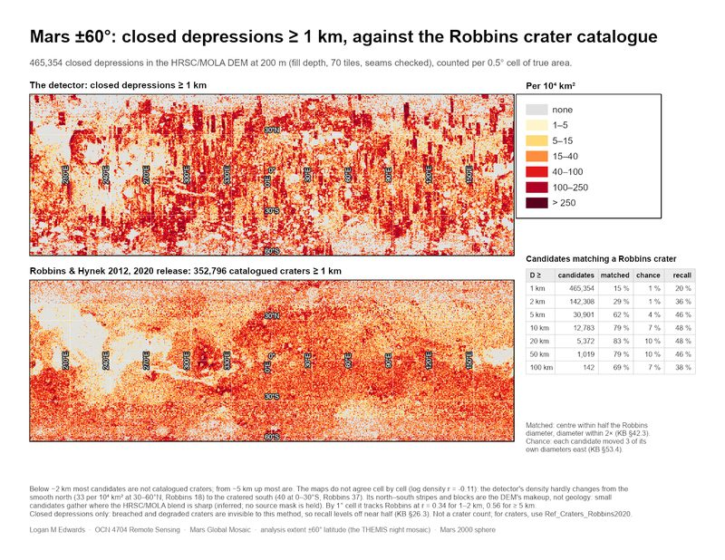</a> | **11 · Closed depressions ≥ 1 km against the Robbins catalogue.** 465,354 depressions per 0.5° cell beside the catalogue's density, and the match rate by diameter. Below ~5 km the density follows the DEM's makeup. KB §53.4, §53.6, §54.4. | `make_global60_candidate_sheets.py` |
| <a href="../Mars%20Project/Global60/layouts/07_global60_basins.png">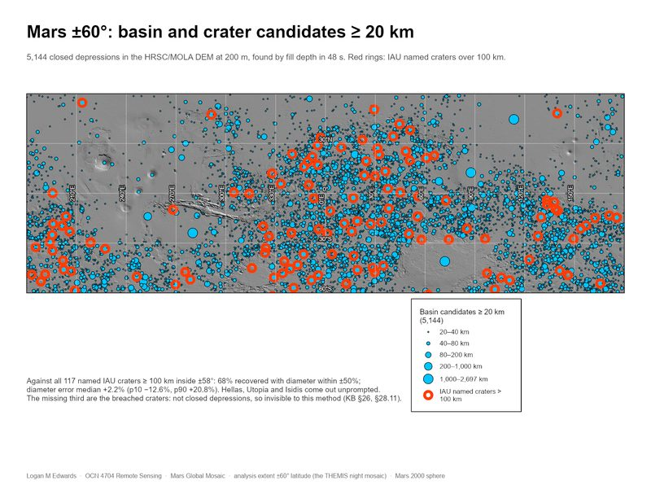</a> | **07 · Basin and crater candidates ≥ 20 km.** 5,144 closed depressions, sized by diameter, with the IAU named craters over 100 km. KB §28.11, §32.1. | `make_candidate_maps.py` |
| <a href="../Mars%20Project/Global60/layouts/12_global60_channels.png">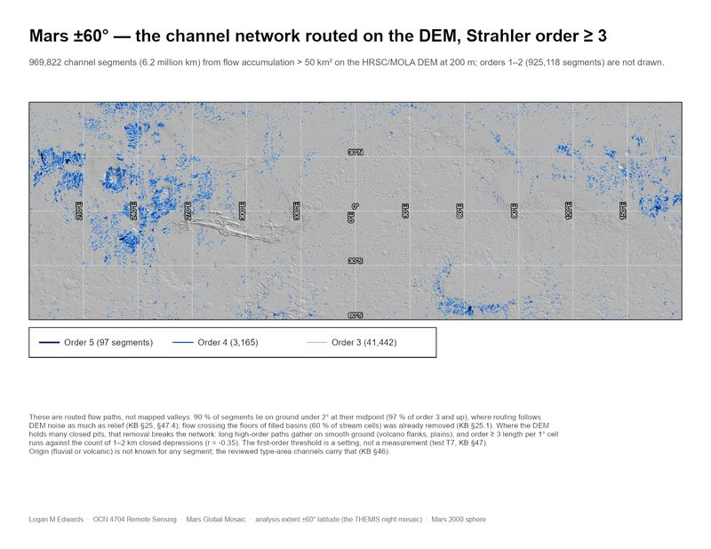</a> | **12 · The channel network routed on the DEM, Strahler order ≥ 3.** 969,822 segments in all; routed flow paths, not mapped valleys. KB §53.4, §53.6, §55.4. | `make_global60_candidate_sheets.py` |
| <a href="../Mars%20Project/Global60/layouts/19_channels_vs_valleys.png">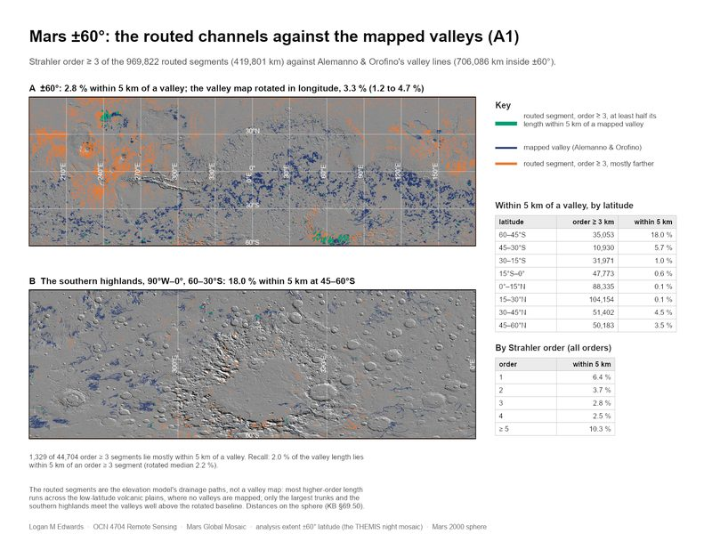</a> | **19 · The routed channels against the mapped valleys (A1).** The order ≥ 3 segments split by whether at least half their length lies within 5 km of an Alemanno & Orofino valley, over ±60° and the southern highlands; within 5 km by latitude and by order. 2.8% overall, no better than the valley map rotated in longitude. KB §69.50. | `make_channel_valley_layout.py` |

### Digitising and validation

| | Sheet | Built by |
|---|---|---|
| <a href="../Mars%20Project/Global60/layouts/06_ius_digitising.png">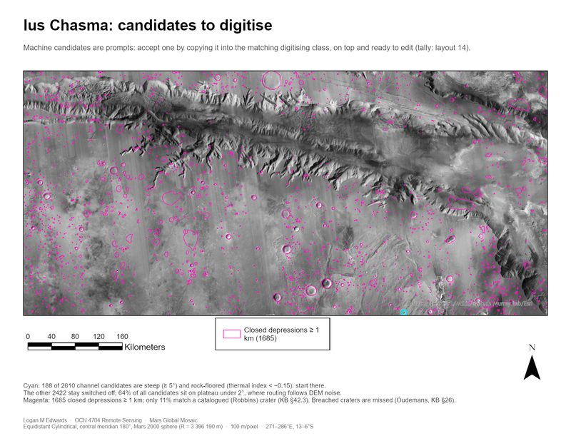</a> | **06 · Ius Chasma, candidates to digitise.** The 188 steep, rock-floored channel candidates and 1,685 closed depressions, over the hillshade. KB §25, §32.1. | `make_candidate_maps.py` |
| <a href="../Mars%20Project/Global60/layouts/09_athabasca_digitising.png">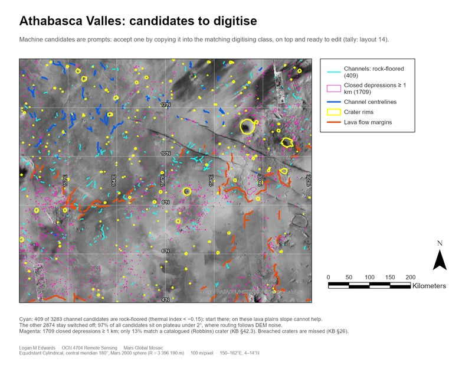</a> | **09 · Athabasca Valles, candidates to digitise.** 409 rock-floored channel candidates and 1,709 closed depressions on the flood lava. KB §42.1. | `make_candidate_maps.py` |
| <a href="../Mars%20Project/Global60/layouts/14_validation.png">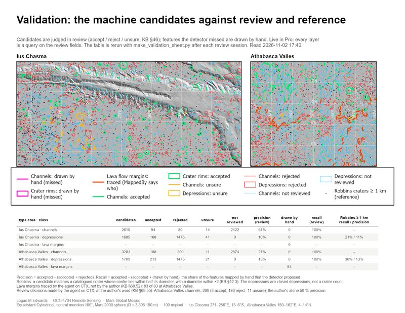</a> | **14 · Validation.** The candidates against the review (accept, reject, unsure) and the Robbins catalogue; the table fills in as the review proceeds. KB §46, §49. | `make_validation_sheet.py` |

## Result charts

Drawn from the tests' JSON logs in [`build/logs/`](../Mars%20Remote%20Sensing%20Project/build/logs) (the province chart
from the KB's own §28.10 tables), never retyped. They are the interim deck's figures, in
[`build/interim_img/`](../Mars%20Remote%20Sensing%20Project/build/interim_img) (the province chart in
[`build/pres1_img/`](../Mars%20Remote%20Sensing%20Project/build/pres1_img)). The deck itself shows navy-ground
copies of these charts and of its layout crops, made by `build/make_interim_dark.py` into `build/interim_img/dark/`
(not tracked: rerun the script to rebuild them; the report and the paper use the white originals). The final
deck, in the same design since 2026-11-03 (D24), has its own made by `build/make_final_dark.py` into
`build/final_img/dark/`, also untracked.

| | What it shows | Made by · log |
|---|---|---|
|  | **T1 in ArcGIS Pro: what each band group adds.** Held-out accuracy of the full stack minus the stack without the group, with a paired-bootstrap 95 % interval. The thermal bands add 1.36 points at 200 m and 1.97 at 400 m, both resolved. KB §56, §56.1. | `make_fig_t1_pro.py` · `t1_bootstrap_*.json` |
|  | **The published map, scored.** A: where each hand-drawn class's held-out area lands, rows summing to 100 %, producer's accuracy on the diagonal and user's under each column (lava tube 2 %). B: held-out accuracy against the majority window at 200 m and 400 m, the published 11 × 11 circled, one class everywhere 58.6 %. KB §55.3, §57. | `make_fig_checks.py` · `global60_classification_check_*.json` |
|  | **T1 with a numpy classifier: held-out accuracy by band set**, against the 58.6 % of one class everywhere. Every set that includes slope and relief clears it; the spectral bands alone do not. KB §40.1. | `make_fig_ablation.py` · `thermal_ablation.json` |
|  | **T3: which layer tracks calibrated thermal inertia (TES)?** Correlation across ±60° and within 15° blocks. Viking red does (r −0.36); the THEMIS pair keeps only a weak local signal. KB §42.4, §43.1. | `make_fig_tes.py` · `tes_global_check.json` |
|  | **T3 by block size:** the pooled within-block r with TES inertia, physical direction up, and the share of blocks with the physical sign, in blocks of 15° to 0.5°. The THEMIS pair peaks inside 2–5° blocks (night IR +0.116) and fades below 2°; Viking falls steadily as the block shrinks. KB §69.29. | `make_fig_tes_scale.py` · `tes_block_scale.json` |
|  | **Can the day–night pair tell material apart across ±60°?** A: the diurnal-contrast index over seven provinces, dusty against rocky −0.0009 with scatter of 0.13–0.23 inside each. B: day IR, night IR and Viking red over the four provinces with tabulated DN; every province repeats the THEMIS mosaic-wide mean and spread, and Viking separates dusty from rocky by 47.67 DN, the THEMIS pair by −0.19 and +0.02. KB §28.10, §62. | `make_fig_global60.py` · KB §28.10's tables, parsed at run time |
|  | **T8: each class's enrichment on each geologic unit group**, P(class \| group) ÷ P(class). Layout 13's table, legible at slide size. KB §43.2, §57.1. | `make_fig_t8.py` · `geomap_check.json` |
|  | **The lava-tube relabel.** Held-out accuracy on the Crater, hills and Normal Ground polygons for four class schemes; a 'volcanic' class from the geologic map is right on 30 % of what it calls volcanic, below the 38 % base rate, so the four hand-drawn classes stay. KB §43.3. | `make_fig_checks.py` · `lava_relabel_test.json` |
|  | **T2: crater density per geologic unit.** Craters ≥ 1 km per 10⁶ km² on each unit ≥ 20,000 km² of the two windows. The catalogue puts `lAv` lowest at Athabasca (1,122); the detector does not, so it cannot date surfaces. KB §42.2. | `make_fig_checks.py` · `crater_density.json` |
|  | **T4 (H2, stage 1): volcanic against fluvial channels.** The Athabasca candidates are shallower than Ius's, and thermal response does not tell the two windows apart (AUC 0.50). KB §51.1. | `make_fig_t4.py` · `t4_channel_h2.json` |
|  | **T5 (H1): does IR show lava-flow margins?** The share of 905 profiles across the geologic map's `lAv` contacts that each band separates; every interval reaches chance. KB §47.2. | `make_fig_tests567.py` · `t5_flow_margins.json` |
|  | **T6 (H3): is the composite more stable than one input?** Agreement of west- and east-trained maps (ARI) and spatial coherence; the composites are the least reproducible. KB §47.3. | `make_fig_tests567.py` · `t6_composite_stability.json` |
|  | **T7 (Q5): how many stream orders does the DEM resolve?** The highest order falls with the channel threshold, and no threshold puts half the first-order cells on real slopes: the count is a setting. KB §47.4. | `make_fig_tests567.py` · `t7_order_sweep.json` |
|  | **Closed depressions against the Robbins crater database**, by minimum diameter: precision rises from 15.3 % at ≥ 1 km to 62.2 % at ≥ 5 km, recall levels off near one half, beside the chance baseline. A final-deck chart. KB §53.4, §69. | `make_fig_final.py` · `global60_candidates_check.json` |
|  | **Crater size-frequency distributions** (A10), cumulative craters ≥ D per km², log-log: at ±60° the closed depressions outnumber Robbins below ~2.8 km (1.32 times at 1 km) and settle near 0.55 of it from 8 to 128 km; at each type area the review's accepts sit below both and reach 53–63 % of Robbins at ≥ 5 km. KB §69.35. | `make_fig_crater_sfd.py` · `crater_sfd.json` |
|  | **The held-out split** (W4): the 15° blocks with training labels and the 14 held out, each label a dot in its class colour. Four classes: 329 training labels in 25 blocks, 183 held out; seven classes: 734 training labels in 129 blocks, 237 held out in the same 14. In the paper as `fig:split`. KB §69.41. | `make_fig_block_split.py` · `block_split.json` (`make_block_split.py`) |
| <a href="../Mars%20Remote%20Sensing%20Project/build/final_img/map_agreement.png">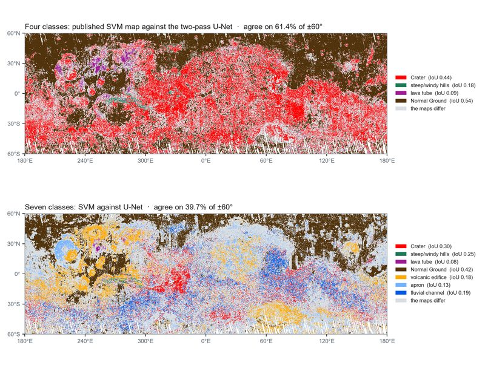</a> | **Where the SVM and U-Net maps agree** (A6): the agreed class in its map colour, grey where the two differ. Four classes, the published SVM map against the two-pass U-Net: 61.4 % of ±60°; seven classes: 39.7 %, the largest disagreement the U-Net's edifice where the SVM gives Normal Ground (13.5 %). Both agree more on the held-out polygons (73.6 %, 43.2 %). KB §69.46. | `make_fig_map_agreement.py` · `map_agreement.json` (`make_map_agreement.py`) |
|  | **The SVM maps against the baselines** (A3): held-out accuracy and balanced accuracy as the majority filter widens from the raw 400 m map to 51 km, four classes above and seven below, against flat lines for the U-Net, the nearest training polygon (83.2 %, 45.6 %), elevation and latitude alone (62.5 %, 31.8 %) and one class everywhere (58.6 %, 29.5 %). Filtering lifts the four-class map to 82.1 %, never above the nearest polygon; the seven-class curve stays flat. KB §69.50. | `make_fig_baselines.py` · `mode_curve.json` (`make_mode_curve.py`), `elevation_baseline.json` (`make_elevation_baseline.py`) |
| <a href="../Mars%20Remote%20Sensing%20Project/build/final_img/typearea_zoom.png">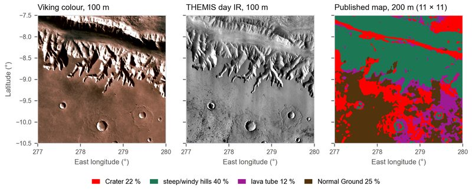</a> | **The published map at full resolution** (W4): Viking colour and THEMIS day IR at 100 m beside the four-class map at 200 m, 277-280 E, 10.5-7.5 S. The map follows terrain: the canyon floor is Crater, the walls and spurs hills, the plateau craters rings of hills, the plains a patchwork. KB §69.50. | `make_fig_typearea_zoom.py` |
| <a href="../Mars%20Remote%20Sensing%20Project/build/final_img/crater_limit.png">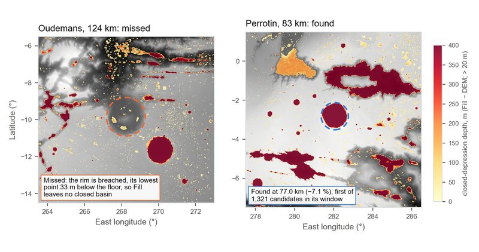</a> | **The crater detector's limit** (W4): closed-depression depth over the elevation model around the two named craters it was tuned on, the IAU rims dashed. Perrotin is found at 77.0 km (-7.1 %); Oudemans is breached, its lowest rim point 33 m below its floor, so filling leaves it empty. KB §26.3, §69.50. | `make_fig_crater_limit.py` |
|  | **T5 (H1) on both sets of margins**: per band, the share of profiles that separate across the 1:20 M geologic map's lAv contacts (open) and across the 86 lava margins traced on CTX (filled), with intervals; chance is 10 %. Day IR leads Viking red by +4.9 points on the traced margins, interval −2.7 to +13.1: H1 not supported on either set. Drafted for the final paper (`v2_drafts.tex` block 15). KB §47.2, §69.52, §69.54. | `make_fig_t5_traced.py` · `t5_flow_margins.json`, `t5_flow_margins_traced.json` (`make_flow_margin_test.py`) |
|  | **The four-class SVM map against the U-Net, class by class:** producer's and user's accuracy on the 183 held-out polygons under one scorer; lava tube's user's accuracy 2.4 % against 77.1 %. A final-deck chart. KB §57, §66.8, §69. | `make_fig_final.py` · `global60_classification_check_*.json` |
|  | **The seven-class SVM and U-Net, class by class:** producer's and user's accuracy on the 237 v2 held-out polygons under one scorer; the U-Net's user's accuracy for apron 79.8 % against 19.0 %. A final-deck and paper chart. KB §69.24, §69.25, §69.27. | `make_fig_final.py` · `global60_classification_check_*v2*.json` |
|  | **Held-out polygons against the probability sample:** each map's score on its polygons beside its estimate on the sample, the AI assistant's labels, whose check failed, so the sample does not rank the maps. The final deck, at the freeze. KB §69.55, §69.79. | `make_fig_final.py` · `global60_classification_check_*v2*.json` |
|  | **The v3 SVM and U-Net, class by class:** producer's and user's accuracy on the 237 v2 held-out polygons under one scorer; 39.1 % against 87.6 %. Paper Figure 24 and the deck: both v3 maps lead (D36). KB §69.81, §69.82. | `make_fig_final.py` · `global60_classification_check_*v3*.json` |
|  | **The U-Net by what its training labels held:** each window map retrained once with the published settings (neither, cut pieces only, added polygons only, both, both without the thermal bands; a second training of the published model once it ends), scored on both held-out sets with block-bootstrap intervals. Paper Figure 25, deck slide 36. KB §69.86, §69.88, §69.93, §69.94. | `make_fig_final.py` · `logs/v3_extras.json` |
|  | **The SVM stand-in by how much ground it sees:** a scikit-learn SVM on the 200 m stack, on one pixel and with each band's mean and spread over windows to 20 km and to 51 km, and to 51 km with the point's map coordinates, trained on each label set, beside the published U-Net at the same test points: surroundings lift it from 39.2 % to 62.0 %, coordinates to 69.2 %, the third label set helps at no window, and the U-Net leads by 26.2 and 19.0 points. Paper Figure 26, deck slide 35. KB §69.95, §69.97, §69.98, §69.100. | `make_fig_final.py` · `logs/svm_label_cap_thermsplit.json` |
| <a href="../Mars%20Remote%20Sensing%20Project/build/final_img/map_agreement_v3.png">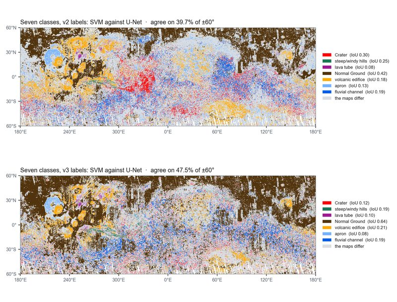</a> | **Where each seven-class pair agrees:** the v2 pair on 39.7 % of ±60°, the v3 pair on 47.5 %. Used only if the author picks a v3 map. KB §69.81. | `make_fig_map_agreement.py` · `map_agreement_v3.json` |

## Type-area figures

The Ius Chasma results that set the method: the segmentation parameters, the `Fill` mask, the detector's limits and
what the day–night pair can show. Drawn from the type-area rasters with `--light`, which writes these to
[`build/interim_img/`](../Mars%20Remote%20Sensing%20Project/build/interim_img); without it, each script writes
Presentation 1's navy original (not mirrored).

| | What it shows | Made by |
|---|---|---|
| <a href="../Mars%20Remote%20Sensing%20Project/build/interim_img/ius_segmentation_sweep.png">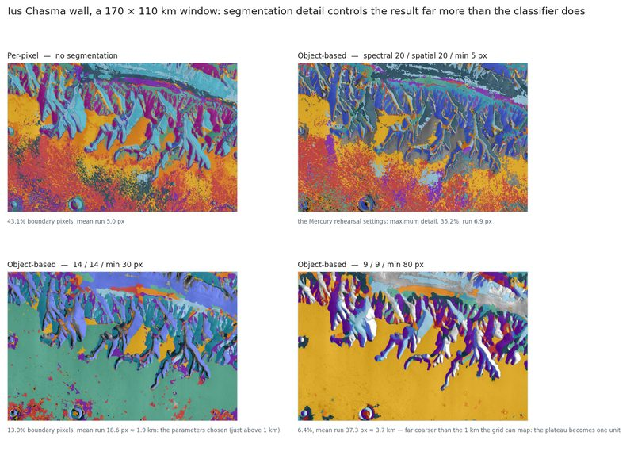</a> | **The segmentation sweep.** The same 170 × 110 km of the chasma wall per pixel and at three object-based settings; boundary pixels fall from 43.1 % to 13.0 % at 14 / 14 / 30, the settings chosen, whose 1.9 km mean run sits just above the grid's 1 km mapping limit. KB §23.5. | `make_fig_segmentation.py --light` |
| <a href="../Mars%20Remote%20Sensing%20Project/build/interim_img/ius_thermal_contrast.png">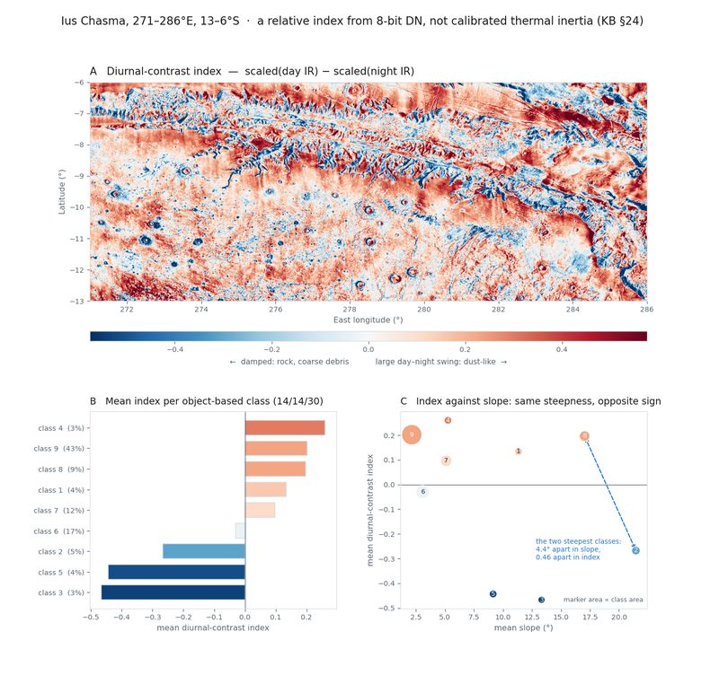</a> | **The diurnal-contrast index at Ius Chasma.** The map, its mean per object-based class, and the class means against slope: the two steepest classes, 4.4° apart, sit 0.46 apart at opposite signs. Relative 8-bit DN, not inertia; at ~3 km it does not track TES. KB §24, §42.4. | `make_fig_thermal.py --light` |
| <a href="../Mars%20Remote%20Sensing%20Project/build/interim_img/ius_channel_candidates.png">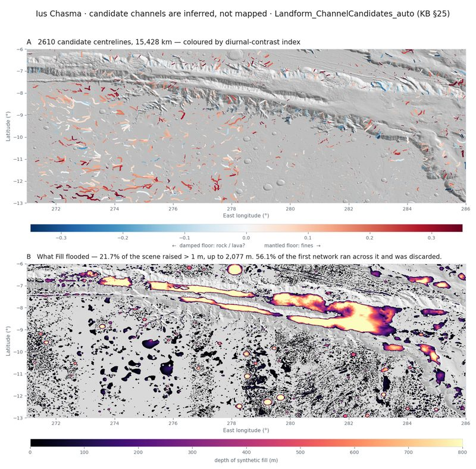</a> | **Channel candidates and the `Fill` trap.** A: the 2,610 candidates by diurnal-contrast index. B: where `Fill` raised the DEM (21.7 % of the area, up to 2,077 m); 56.1 % of the first network ran across it. KB §25. | `make_fig_channels.py --light` |
| <a href="../Mars%20Remote%20Sensing%20Project/build/interim_img/ius_crater_candidates.png">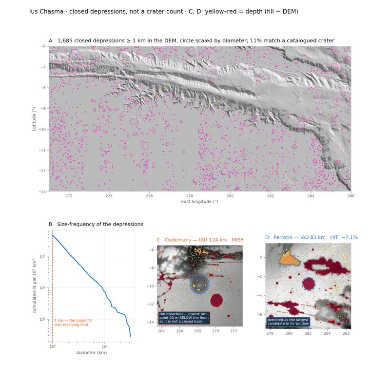</a> | **Closed depressions and the detector's limit.** The 1,685 depressions ≥ 1 km, their size-frequency, and two named craters: Oudemans, breached, missed; Perrotin found within 7.1 %. KB §26, §42.3. | `make_fig_craters.py --light` |

## Check images

[`Mars Project/Global60/checks/dem_step_chips_20261015/`](../Mars%20Project/Global60/checks/dem_step_chips_20261015):
image chips at each line in the DEM that the sweep of the 7-band stack flagged (steps 2.2–4× the local roughness, ~500 km
long). 297.5°E is a real escarpment; the others are seams and smoothed gap-fill strips in the HRSC/MOLA blend, not fixable
in this project. `180E_col53346_after_fix` shows the 180° column after its patch. KB §54, §55.2.

| | | |
|---|---|---|
| <a href="../Mars%20Project/Global60/checks/dem_step_chips_20261015/180E_col53346_after_fix.png">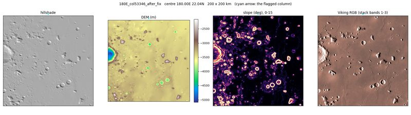</a> 180°E, after the fix | <a href="../Mars%20Project/Global60/checks/dem_step_chips_20261015/297.5E_col88163.png">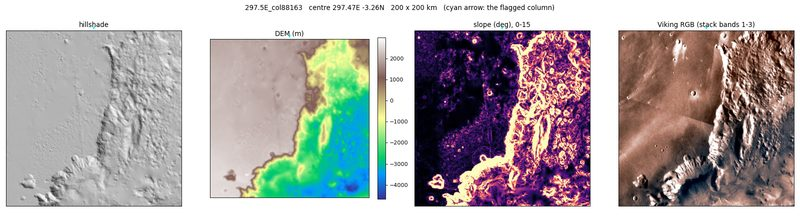</a> 297.5°E, a real escarpment | <a href="../Mars%20Project/Global60/checks/dem_step_chips_20261015/304.4E_col90211.png">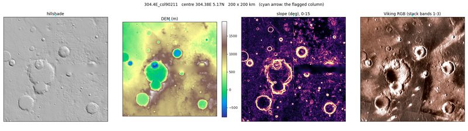</a> 304.4°E, a seam |
| <a href="../Mars%20Project/Global60/checks/dem_step_chips_20261015/345.8E_col102499_a.png">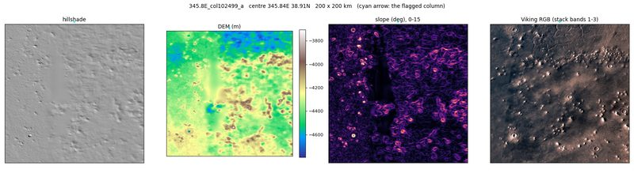</a> 345.8°E (a), a seam | <a href="../Mars%20Project/Global60/checks/dem_step_chips_20261015/345.8E_col102499_b.png">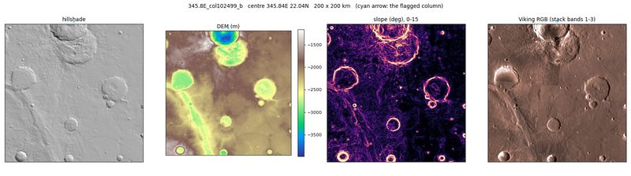</a> 345.8°E (b), a seam | <a href="../Mars%20Project/Global60/checks/dem_step_chips_20261015/61.9E_col18333.png">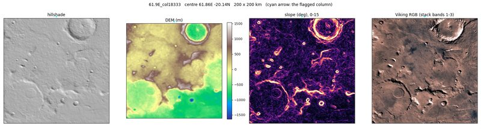</a> 61.9°E, a seam |
| <a href="../Mars%20Project/Global60/checks/dem_step_chips_20261015/15.0S_row22230.png">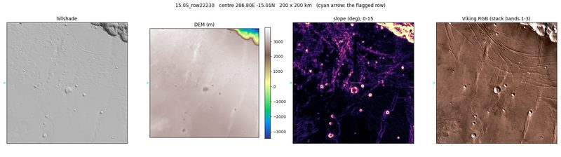</a> 15.0°S (a row), a seam | | |

### The v3 label screens (2026-11-01)

[`build/logs/v3_label_sheets/`](../Mars%20Remote%20Sensing%20Project/build/logs/v3_label_sheets): per seven-class class,
eight accepted and four rejected rows of `propose_v3_labels.py` (solid accepted, dashed rejected) over DEM hillshade,
the read by eye behind the v3 labels. The rows are accepted by a written rule, not reviewed. KB §69.49.

| | | |
|---|---|---|
| <a href="../Mars%20Remote%20Sensing%20Project/build/logs/v3_label_sheets/v3_class1_Crater.png">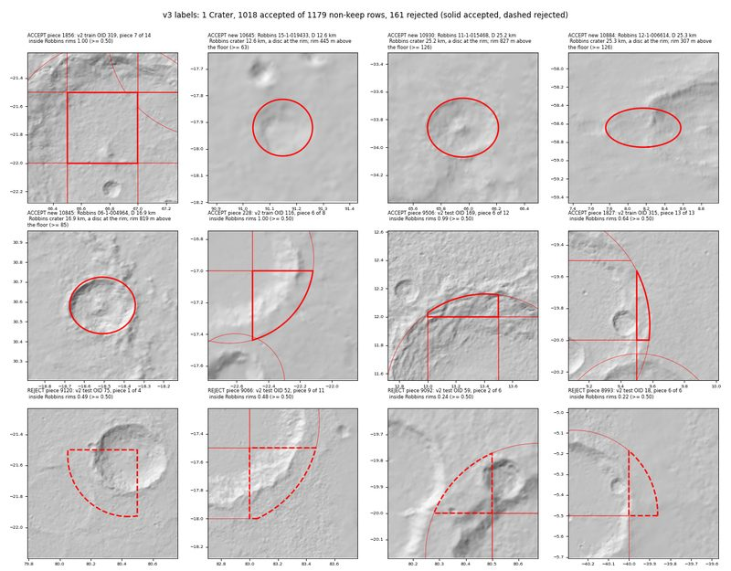</a> 1 Crater: Robbins discs and pieces of the hand-drawn polygons, pieces outside the rims rejected | <a href="../Mars%20Remote%20Sensing%20Project/build/logs/v3_label_sheets/v3_class2_steep_windy.png">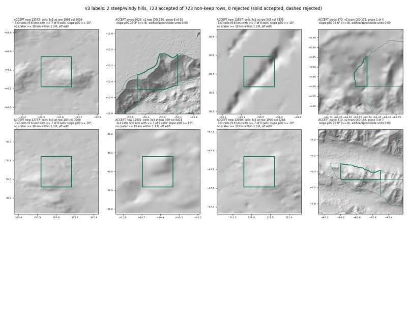</a> 2 steep/windy hills: 3 × 3-cell squares on steep, high-relief ground and pieces of the hand-drawn polygons | <a href="../Mars%20Remote%20Sensing%20Project/build/logs/v3_label_sheets/v3_class3_lava.png">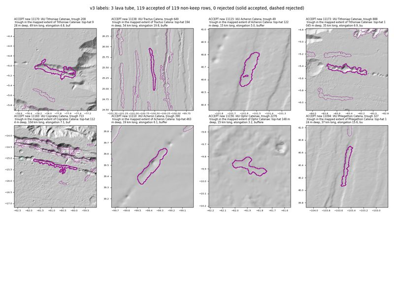</a> 3 lava tube: troughs in the mapped extent of the named catenae |
| <a href="../Mars%20Remote%20Sensing%20Project/build/logs/v3_label_sheets/v3_class4_Normal.png">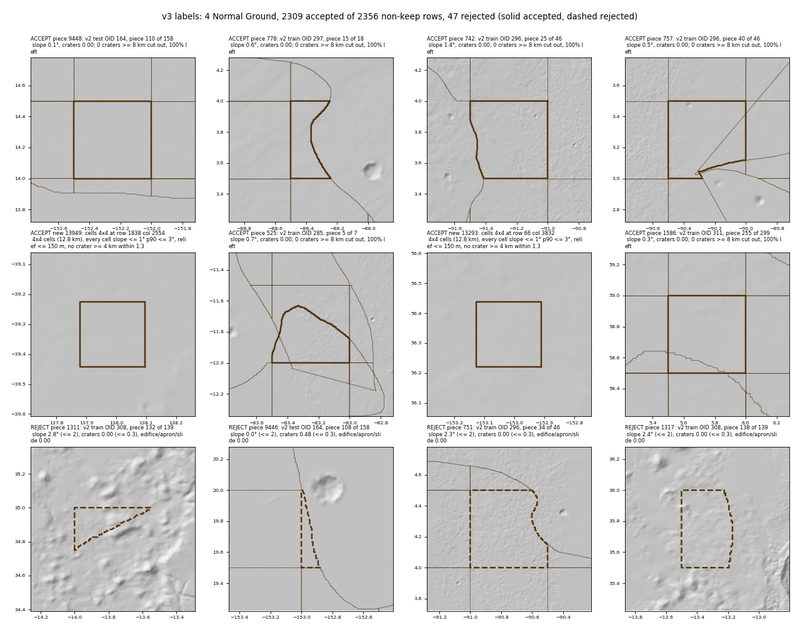</a> 4 Normal Ground: smooth crater-free squares and pieces of the hand-drawn polygons, cratered pieces rejected | <a href="../Mars%20Remote%20Sensing%20Project/build/logs/v3_label_sheets/v3_class5_volcanic.png">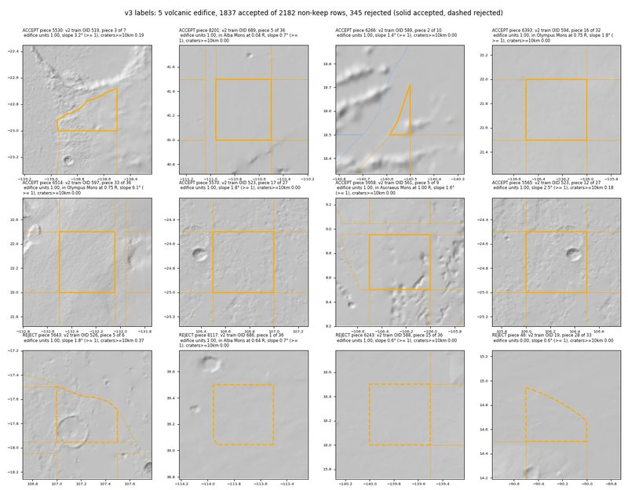</a> 5 volcanic edifice: pieces of the edifice units, flat ones rejected | <a href="../Mars%20Remote%20Sensing%20Project/build/logs/v3_label_sheets/v3_class6_apron.png">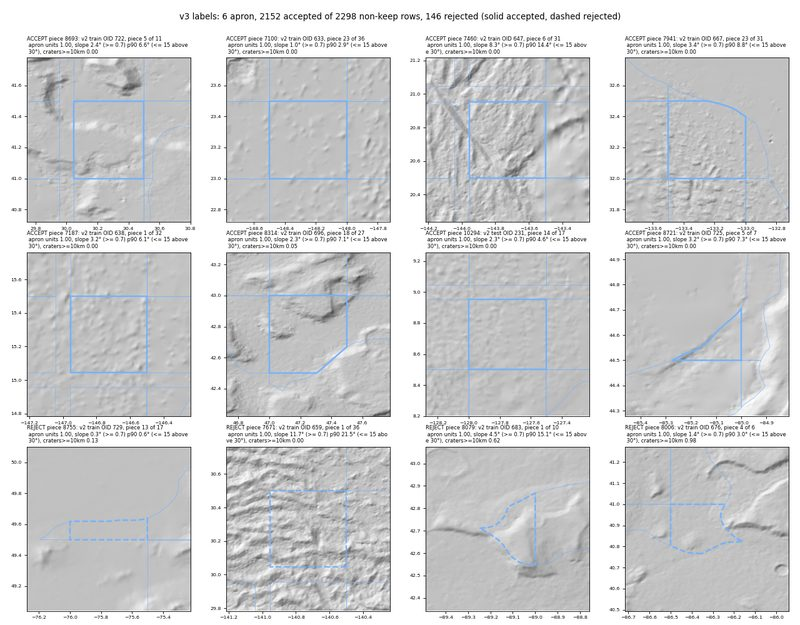</a> 6 apron: pieces of the apron units, rough mid-latitude ones rejected |
| <a href="../Mars%20Remote%20Sensing%20Project/build/logs/v3_label_sheets/v3_class7_fluvial.png">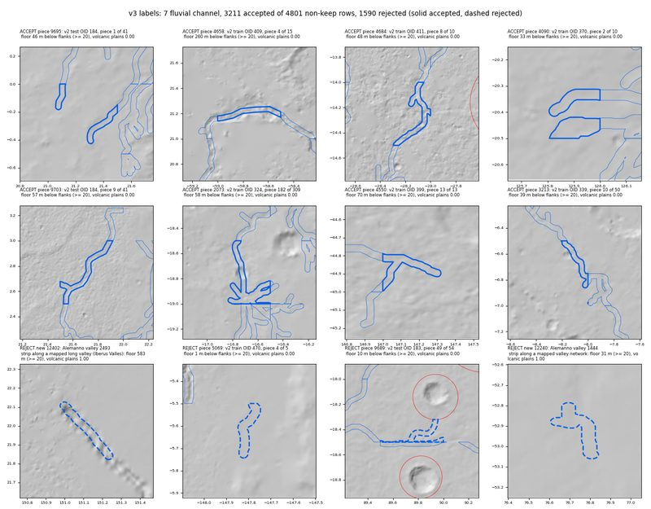</a> 7 fluvial channel: valley strips and their pieces, those not on a floor rejected |  |  |

## Deep-learning model (X5)

Written by `TrainDeepLearningModel` beside the model in
[`Mars Project/DLModels/global60_retinanet_20261019/`](../Mars%20Project/DLModels/global60_retinanet_20261019) (the
weights, 137–146 MB, stay on the drive). Validation chips come from the training split: **not the held-out score**.
KB §66.1.

| | What it shows | Made by |
|---|---|---|
|  | **Training and validation loss**, nine epochs of RetinaNet on the 7-band chips; early stopping kept epoch 3 (validation loss 1.567). | `make_dl_model.py --train` |
| <a href="../Mars%20Project/DLModels/global60_retinanet_20261019/ModelCharacteristics/show_results.png">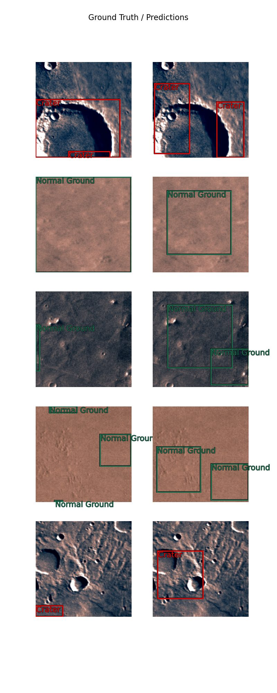</a> | **Labels against predictions** on five validation chips: the right class on crater and plains chips, boxes unlike the labels' whole-chip extents (validation AP ≤ 0.010 per class). | `make_dl_model.py --train` |

### X5b and X5c (2026-10-20)

The retrained detector and the U-Net, in [`global60_retinanet_x5b_20261020/`](../Mars%20Project/DLModels/global60_retinanet_x5b_20261020)
and [`global60_unet_x5c_20261020/`](../Mars%20Project/DLModels/global60_unet_x5c_20261020); validation chips from the
training split, **not the held-out score** (KB §66.5–66.6).

| | What it shows | Made by |
|---|---|---|
|  | **X5b loss**, 30 epochs with the backbone unfrozen and no early stopping; validation loss 428 after the first epoch, 1.2–4.4 after; epoch 16 kept (1.203). | `make_dl_model.py --train` |
| <a href="../Mars%20Project/DLModels/global60_retinanet_x5b_20261020/ModelCharacteristics/show_results.png">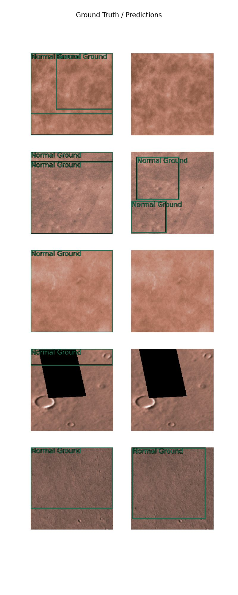</a> | **X5b labels against predictions** on five validation chips, all Normal Ground: three get no box, one two boxes smaller than the label, one a box close to it (its validation AP for Normal Ground is 0.000). | `make_dl_model.py --train` |
|  | **X5c loss**, the U-Net, 30 epochs; validation loss 0.466 to 0.029, epoch 29 kept. | `make_dl_pixels.py --train` |
|  | **X5c labels against predictions** on five validation chips: the labelled crater right, and the whole chip around it called Crater too (the provinces of KB §66.6). | `make_dl_pixels.py --train` |

### The seven-class rehearsal U-Net (2026-10-25)

Trained on the rehearsal labels, every proposal taken as proposed and **not the author's review**, in
[`global60_unet_x5c_v2p_20261025/`](../Mars%20Project/DLModels/global60_unet_x5c_v2p_20261025): a test of the
v2 pipeline, never a result (KB §69.4). Validation chips from the training split, not the held-out score.

| | What it shows | Made by |
|---|---|---|
|  | **Rehearsal U-Net loss**, seven classes, 30 epochs over 21,711 chips (7.8 h); validation loss from 0.81 to 0.25. | `make_dl_pixels.py --train --labels v2p` |
|  | **Rehearsal U-Net labels against predictions** on five validation chips: around a valley strip the whole chip is called fluvial channel, with volcanic edifice at its edge; a second chip is called apron throughout and its channel strip is missed; the last three are called Normal Ground. | `make_dl_pixels.py --train --labels v2p` |

### The seven-class U-Net on the reviewed labels (2026-10-28)

Trained on the reviewed v2 labels (KB §69.8) in
[`global60_unet_x5c_v2_20261028/`](../Mars%20Project/DLModels/global60_unet_x5c_v2_20261028): 69.0 %, κ 0.606 on the 237 held-out polygons, the current
seven-class U-Net, beside the four-class one (KB §69.25, §69.26). Validation chips from the training split, not the held-out score.

| | What it shows | Made by |
|---|---|---|
|  | **v2 U-Net loss**, seven classes, 30 epochs over 17,444 chips (6.2 h); validation loss from 0.90 to 0.30. | `make_dl_pixels.py --train --labels v2` |
|  | **v2 U-Net labels against predictions** on five validation chips: a branching valley network is called apron and fluvial channel across the whole chip, with Crater on the crater beside it; a chip with two channel strips is called volcanic edifice throughout and the strips are missed; two chips labelled Normal Ground in part are called Normal Ground throughout; a chip with volcanic edifice in one corner is called volcanic edifice throughout, with Crater on its small crater. | `make_dl_pixels.py --train --labels v2` |

### The seven-class U-Net on the v3 labels (2026-11-05)

Trained on the v3 labels (KB §69.49) in
[`global60_unet_x5c_v3_20261105/`](../Mars%20Project/DLModels/global60_unet_x5c_v3_20261105); the epoch of lowest validation loss, 18 of 0–29, is the
model kept (KB §69.76). Its map scores 87.6 %, κ 0.844 on the 237 held-out v2 polygons (layout 17c, KB §69.80). The rows after its own two are the extra runs' retrainings: on 14 fresh blocks, without the thermal bands, on the cut pieces alone, on the added polygons alone, and on a second fresh draw (KB §69.84–§69.96). Validation chips from each model's training split.

| | What it shows | Made by |
|---|---|---|
|  | **v3 U-Net loss**, seven classes, 30 epochs over 34,841 chips (12.1 h); validation loss falls to 0.46 at epoch 18, then spikes as high as 23, cause not verified. | `make_dl_pixels.py --train --labels v3` |
|  | **v3 U-Net labels against predictions** on five validation chips: most of each chip is unlabelled, the polygons cut square by the 0.5° grid. A sliver of Normal Ground is called Normal Ground throughout; apron is called apron; straight-edged edifice pieces are called as patchy edifice and Normal Ground; a Crater disc is called Crater, the crater beside it too, with fluvial channel and edifice on the unlabelled plain around it. | `make_dl_pixels.py --train --labels v3` |
|  | **Fresh-block U-Net loss** (make_v3_extras.py, run fresh: 14 other blocks held out, KB §69.84), 30 epochs over 31,960 chips (10.8 h); the epoch of lowest validation loss, 22 (0.451), is the one kept; validation loss then spikes to 11.9 at epoch 25 and training loss further, as in the v3 run. | `make_v3_extras.py --run fresh --step train` |
|  | **Fresh-block U-Net labels against predictions** on validation chips, written by the training tool. | `make_v3_extras.py --run fresh --step train` |
|  | **No-thermal U-Net loss** (make_v3_extras.py, run noth: the v3 labels on the five bands without thermal, KB §69.86), 30 epochs (11.7 h); the epoch of lowest validation loss, 21 (0.502), is the one kept; validation loss then rises to 892.0 at epoch 28, the late spikes of every v3 run. | `make_v3_extras.py --run noth --step train` |
|  | **No-thermal U-Net labels against predictions** on validation chips, written by the training tool. | `make_v3_extras.py --run noth --step train` |
|  | **Cut-only U-Net loss** (make_v3_extras.py, run cut: the v2 polygons' screened pieces alone, 7,401 polygons, KB §69.88), 30 epochs (6.7 h); the epoch of lowest validation loss, 21 (0.235), is the one kept; unlike every v3 run trained on the added polygons, validation loss never rises above 1.32. | `make_v3_extras.py --run cut --step train` |
|  | **Cut-only U-Net labels against predictions** on validation chips, written by the training tool. | `make_v3_extras.py --run cut --step train` |
|  | **Added-only U-Net loss** (make_v3_extras.py, run add: the second label set plus the added polygons, 3,602 polygons, KB §69.93), 30 epochs (12.1 h); the epoch of lowest validation loss, 22 (0.433), is the one kept; validation loss rises above 2 from epoch 20 and peaks at 3.51, between the cut-only run and the full v3 runs. | `make_v3_extras.py --run add --step train` |
|  | **Added-only U-Net labels against predictions** on validation chips, written by the training tool. | `make_v3_extras.py --run add --step train` |
|  | **Second fresh-block U-Net loss** (make_v3_extras.py, run fresh2: a second draw of 14 other blocks held out, KB §69.96), 30 epochs over 31,229 chips (11.2 h); the epoch of lowest validation loss, 16 (0.571), is the one kept; validation loss rises above 2 from epoch 18 and peaks at 943.74. | `make_v3_extras.py --run fresh2 --step train` |
|  | **Second fresh-block U-Net labels against predictions** on validation chips, written by the training tool. | `make_v3_extras.py --run fresh2 --step train` |

## Interim crops

[`build/interim_img/`](../Mars%20Remote%20Sensing%20Project/build/interim_img) also holds each layout the interim deck
shows, exported at 200 dpi with the sheet's own prose hidden by
[`make_interim_figs.py`](../Mars%20Remote%20Sensing%20Project/build/make_interim_figs.py). A sheet with a legend yields
three files: the whole sheet, `__map` (the map alone, full width on the slide) and `__legend`. They are the same maps as
the layouts above, all 13 re-exported from the current sheets on 2026-10-22 (KB §67).

[`build/final_img/`](../Mars%20Remote%20Sensing%20Project/build/final_img) holds the same kind of crops for the
final deck (layouts 04, 04b, 04c, 07, 08, 10, 12, 15, 16, 17, 17b, 17c), exported by
[`make_final_figs.py`](../Mars%20Remote%20Sensing%20Project/build/make_final_figs.py), beside the three charts above. The
final paper's [`figures/`](../Mars%20Remote%20Sensing%20Project/NEXT%20STUFF/Final/paper/figures) folder holds copies of
figures on this page, put there by `build_final_paper.py` so the `.tex` compiles on its own (KB §69).

## Other

| | What it shows | Made by |
|---|---|---|
| [`pipeline.svg`](pipeline.svg) | The pipeline diagram on the front page: four sources, one ±60° grid, the products, both rounds of hand-drawn labels, the SVM and the U-Net with their seven-class and four-class scores, and the candidates. KB §69.38. | by hand |
| [`final_img/pipeline.pdf`](../Mars%20Remote%20Sensing%20Project/build/final_img/pipeline.pdf) · [`pipeline.png`](../Mars%20Remote%20Sensing%20Project/build/final_img/pipeline.png) | The same diagram rendered for the paper, the footnote left to the caption: one vector page and a 2,200 × 892 PNG. In the paper's Methods (`fig:pipeline`). KB §69.38. | `make_fig_pipeline.py` |
| [`NEXT STUFF/Final/paper/mars_global_mosaic.pdf`](../Mars%20Remote%20Sensing%20Project/NEXT%20STUFF/Final/paper/mars_global_mosaic.pdf) | The final paper, a draft in AASTeX 7 (25 pages, the references included); the machine products presented as candidates while the review is open. KB §69. | `build_final_paper.py` |
| [`NEXT STUFF/Mars Mosaic - Interim Report.pdf`](../Mars%20Remote%20Sensing%20Project/NEXT%20STUFF/Mars%20Mosaic%20-%20Interim%20Report.pdf) | The interim report, submitted 5 November 2026: 21 pages, 21 figures, the data cut 26 October (D20), its Viking wording corrected 3 November. KB §69.64. | `build_interim_report_live.py`, rendered through Word |
| [`OLD/ocean first pres LE.pdf`](../Mars%20Remote%20Sensing%20Project/OLD/ocean%20first%20pres%20LE.pdf) | Presentation 1 as delivered (history, not corrected). KB §14.5. | — |
